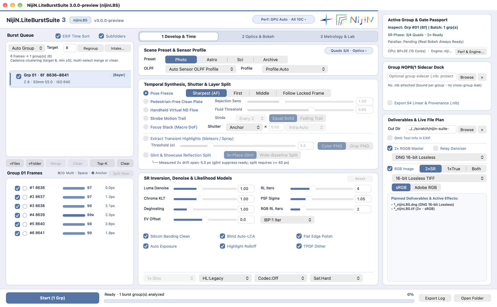
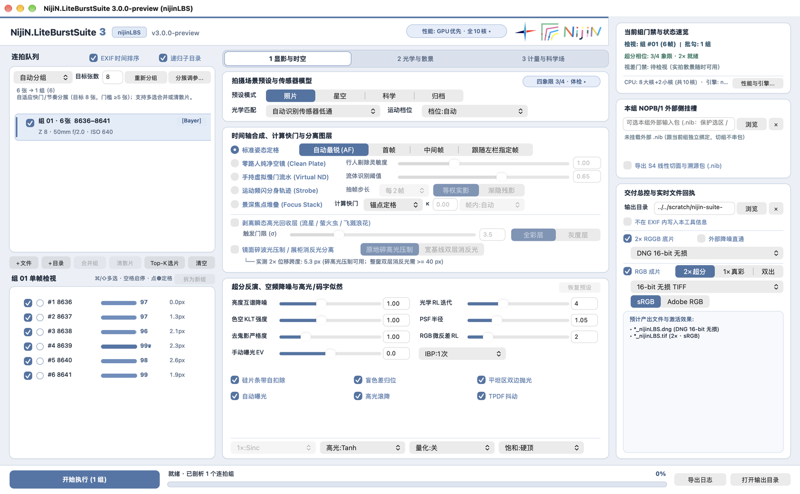
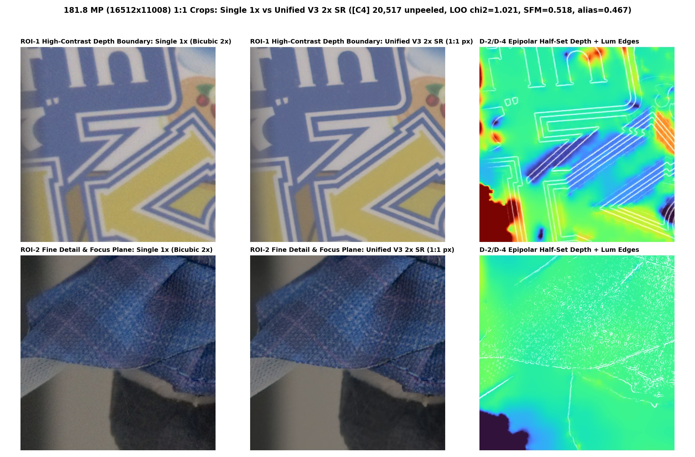
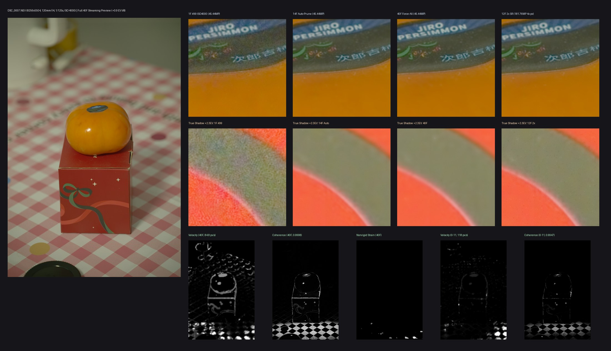
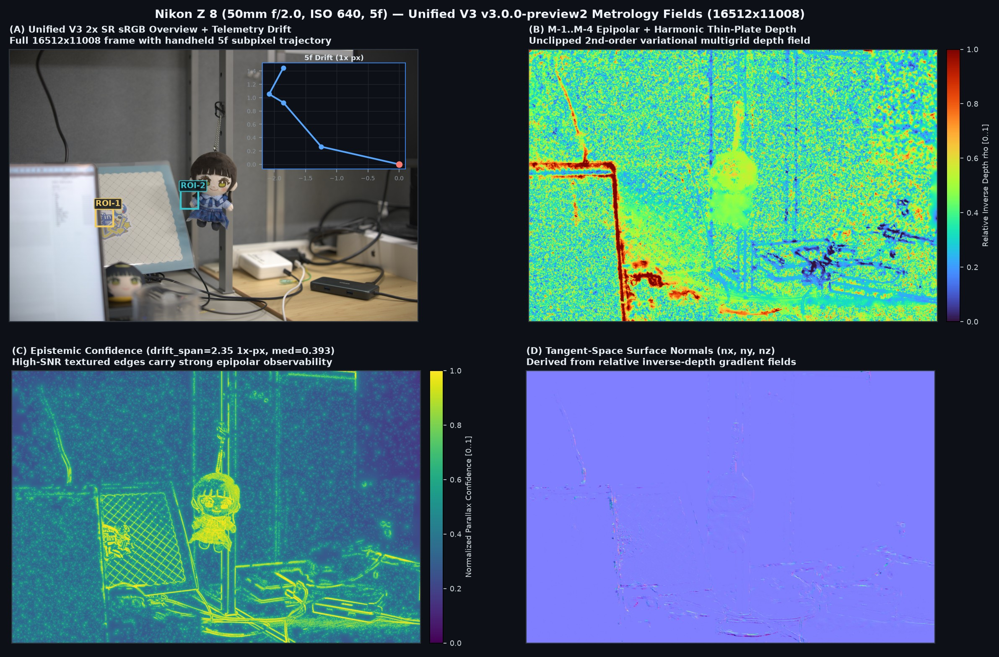
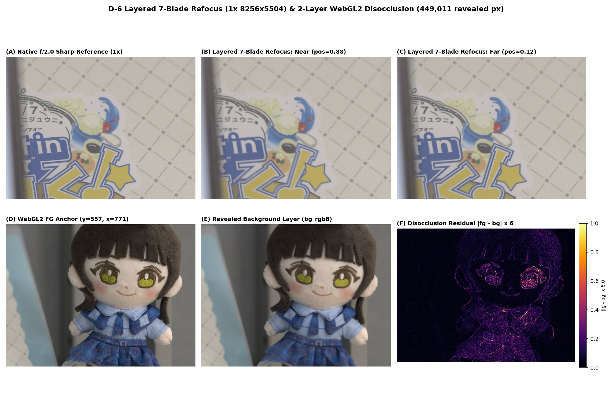

<p align="center">
  
</p>

# NijiN.LiteBurstSuite (`nijinLBS`)

**[English](#nijinliteburstsuite-nijinlbs) · [简体中文](#nijinliteburstsuite-nijinlbs-简体中文)**

**Download / 下载：[`NijiN.LiteBurstSuite v3.0.0-preview-fix2` (macOS · Windows · Linux)](https://github.com/A2Sumie/NijiN.LiteBurstSuite/releases/tag/v3.0.0-preview)**

**Multi-Frame RAW Imaging Suite** (`Metal` · `Vulkan` · `ARM64 NEON` · `x86_64 AVX2`)

> **Current Release: `v3.0.0-preview-fix2` — Unified V3, `nijinWVDC` (`.NEV` / `HE` / `ARW6` / `.DXO`), Open `.nlens` v1 Optical Calibration, Split-Half FRC Suitability, 17 RGB & 27 Field Formats**

`NijiN.LiteBurstSuite` (**`nijinLBS`**) provides multi-frame **`2×` RAW/RGB super-resolution, native `1×` 16-bit True-Sampled RGB enhancement, temporal synthesis, 27 physical fields, `8×` linear RAW optics metrology, multi-regime physical refocusing, `OP-O1..O3` handheld single-focus optical operators, `O1–O10` scientific observer telemetry, `NOPB/1` native sidecar bus, and paired training dataset generation**. Native desktop applications are built with `AppKit` (macOS) and `Win32 GDI+` (Windows), sharing a 3-column × 3-workspace studio (`1 Develop & Time`, `2 Optics & Bokeh`, `3 Metrology & Lab`) with full engine parameter coverage, a persistent Burst Queue / Intake Tuner & Frame AF Inspector, group-isolated `NOPB/1` sidecar docking, external `.lng` live language switching (`en-US` / `zh-CN`), one-click session diagnostic log export, and `--no-tool-exif` privacy control. Built-in first-party **`nijinWVDC`** + **`LibRaw 0.23-HE*`** natively supports Bayer, Fujifilm `6×6` X-Trans, Nikon `.NEV` video RAW containers (`#frame=K`), `.jxs`, Nikon Z8/Z9 HE/HE\*, Sony ARW6, and `.DXO` SuperRAW.

> **Design Guarantees — Purely Mathematical · Strictly Deterministic · Zero Learned Priors · Zero Hallucination**
> - **Purely Mathematical**: 100% explicit optical sampling geometry and Poisson-Gaussian photon statistics — zero neural networks, zero black-box weights, zero external model files.
> - **Strictly Deterministic**: Bit-for-bit reproducible output for fixed inputs, parameters, and compute backend (CPU row reductions are thread-count and schedule invariant, and even 16-bit TPDF dither uses stateless pixel-coordinate `SplitMix64` hashing rather than random seeds; cross-backend differences between CPU SIMD, Metal, and Vulkan reflect IEEE-754 FMA/SFU rounding only, `PSNR > 82–103 dB`).
> - **Zero Learned / External Priors**: Zero training datasets, zero learned image distributions, and zero patch dictionaries; uses only first-principles sensor physics ($\text{Var}(I)=\sigma_0^2+gI$, CFA/OLPF diffraction geometry) and local analytical signal regularizers (inter-channel chroma-difference smoothness, local color-line linearity, empirical DCT/wavelet Wiener shrinkage).
> - **Zero Hallucination**: Every reconstructed value traces directly to captured photons across the burst; physically unobserved subpixel phases or parallax are explicitly flagged via `_field_phase` and observability gates rather than synthesized.

<p align="center">
  
  
</p>

## Suite Workspaces

| Zone / Workspace | Key Capabilities |
|---|---|
| **Left Queue, Intake & Frame Dock** | EXIF cadence burst clustering, `Intake...` tuner (decoder route, `.NEV` frame slice, burst gap, min rel sharpness, max shift, lucky imaging, max cluster frames), per-frame AF score & pose lock |
| **1 Develop & Time** | `Photo / Astro / Sci / Archive` presets, open `.nlens` v1 optical profiles (`--lens-profile auto\|off\|path.nlens`), `Pose Freeze / Clean Plate / Virtual ND / Strobe / Focus Stack`, computational shutter, transient/de-glint layers, `2×` SR / `1×` `fast\|sinc\|joint` / `OLPF`, IBP `0..2`, `Q4/Q5` Probit & zero-temp-disk stripe budget |
| **2 Optics & Bokeh** | Linear optical glass diffusion (`HDF / Black Mist / Ultra Contrast / Halation`, neutral/warm), `OP-O1` Sellmeier continuous spectral CA, `OP-O3` chiral swirl/de-nisen/aspect/onion bokeh shaping, 2.5D HTML viewer & `OP-O2` 3-disc positive STF physical refocusing |
| **3 Metrology & Lab** | Subpixel trajectory, $4\times 4$ Brillouin Schur completeness ($\Phi_L$) & Split-Half `FRC` suitability scorecard (`[Metrics]`), `8×` linear RAW stellar ePSF / slanted-edge MTF50 radar, `.lcp` / passport PNG / telemetry JSON, 27 selectable `--fields` (`native\|1x\|2x`, `png\|tiff\|jxl\|exr\|webp\|nib`, `u8\|u16\|f16\|f32\|log16\|oct32`), `O1–O10` scientific observers & dataset tiles |
| **Right Gate, `NOPB/1` & Delivery Dock** | Live SR suitability (`STRONG_2X / MARGINAL_2X / RECOMMEND_1X`) & parallax gates, group-isolated `.nib` sidecar input/export, `SOF3` DNG / `LinearRaw` & **17 streaming RGB formats** (`TIFF Deflate/HQ/LZW/8/Raw`, `PSD/PSB`, `JPEG XL`, `JPEG 2000`, `PNG 16/8`, `JPEG 4:4:4`, `WebP`, `EXR`, `JPEG XS`) |

## Visual Showcase & Measured Metrics (`v3.0.0-preview`)

<p align="center">
  
  
</p>
<p align="center">
  
  
</p>

| Verification / Benchmark Item | Real Corpus / Configuration | Measured Objective Metrics |
|---|---|---|
| **Nikon Z8 `45.7 MP -> 181.8 MP` (`16512×11008`)** | 5-frame handheld burst (`50mm f/2.0`, `ISO 640`), Apple M1 Max `Metal` | **`8.45 s`** (`1×`) / **`13.30 s`** (`2×`); `LOO χ²(all = 1.0212, flat = 1.0015)`, `SFM = 0.518`, `max_parallax = 3.23 2×-px` (`coh = 0.882`) |
| **Desktop GPU `Vulkan 1.0` (`49` SPIR-V)** | `NVIDIA RTX 4080 SUPER` + `Ryzen 7 5800X3D`, Z8 `HE*` (`182.8 MP`, 6f) & Z8 `1536²` crop (`2×` + `O7/O8` + `NOPB/1`) | **`16.97 s`** (`182.8 MP` end-to-end); **`0.82 s`** (`1536²` `2×` Vulkan stage45 `0.02 s + 0.02 s` + swirl bokeh + `.nib` export) |
| **Cross-Backend & Stripe Streaming Parity** | CPU `AVX2/NEON` vs `Metal`/`Vulkan`; `DXO_0820.DXO` (`11088×7388` `2×`, 31 stripes at `1 GiB` stripe target) | `1×` linear CPU/Metal `RMSE = 9.37e-5` (**`80.57 dB`**), 16-bit RGB **`PSNR > 82–103 dB`**; DxO 31-stripe vs full-frame **`59.39 dB`** with **`0 B`** temp disk files |
| **Handheld Optics (`OP-O1..O3`)** | 3-disc positive STF (`R=32`, `u=1.0`), Sellmeier equal-shift CA (`16 px`), `2 px` bokeh erosion (`50%` anti-aliased edge) | STF `min OTF >= -1e-6` up to `Rω = 16 rad`; Spectral CA `Q = 38` nodes (`max_step = 0.579 px`, pure-blue impulse red `min = 0.00e+00`); Bokeh `fg_delta = 0.0`, `bg_halo = 0.0` |
| **Lossless & Visually-Lossless Storage** | Z8 `45.7 MP -> 181.8 MP` `2×` masters | `SOF3` 16-bit Lossless DNG **`0.39×`** (`dng-hq` **`0.09×`**); `Predictor=2` 16-bit Lossless TIFF **`0.39×`** (`tiff-hq` **`0.19×`** raw / **`0.48×`** lossless TIFF) |

See [Implementation Mapping](docs/IMPLEMENTATION.md) for source entry points and test targets, and [Specification Index](docs/README.md) for design volumes. Measurements report explicit units, sample counts, and validity gates; benchmarks in [Performance Analysis](docs/PERFORMANCE.md) record image sizes, frame counts, and active stages.

> **Documentation Index**: [**`ALGORITHM.md` (Core Physics & Physical Field Maps)**](ALGORITHM.md) ｜ [**`CLI.md` (CLI Options & Convergence Reference)**](CLI.md) ｜ [**`NOTICE.md` (Third-Party Attributions)**](NOTICE.md)

---

## Super-Resolution Foundation

Baseline convergence and compression ratios below reference fixed Nikon Z8 samples from `v1.6.4`; Suite stages are verified with independent boundary tests and real full-resolution RAW regressions (`docs/VALIDATION.md`).

- **Zero-Dependency Cross-Platform GPU + SIMD Acceleration (`--backend auto|gpu|cpu`)**
  - **macOS (`Metal`)**: Native `Metal.framework` unified zero-copy compute (`MTLResourceStorageModeShared`).
  - **Windows / Linux (`Vulkan`)**: Embeds 49 precompiled Vulkan 1.0 `SPIR-V` compute shaders using the GPU driver's native `vulkan-1.dll` / `libvulkan.so.1` (NVIDIA / AMD / Intel, zero external SDKs). Unified V3 executes end-to-end across CPU / Metal / Vulkan (`8.45s` `1×` / `13.30s` `2×` on 45.7 MP Nikon Z8 5-frame bursts on Apple M1 Max Metal; `v2.1` baseline measured `16.97 s` for 6-frame Z8 HE\* `182.8 MP` on `RTX 4080 SUPER` + `5800X3D`). Desktop discrete GPUs outrank integrated GPUs automatically; mobile APUs and pre-Xe2 Intel iGPUs default to optimized CPU execution unless GPU is selected.
  - **CPU fallback (`ARM64 NEON` / `x86_64 AVX2`)**: Cache-topology-aware streaming (`heraw_cpu_cache.hpp`), AC/DC battery detection (disabling SMT by default on battery), and cross-backend 16-bit parity exceeding **`PSNR > 82 dB`**.
- **Lossless-First Encoding & Visually-Lossless Lossy Modes (Full EXIF/GPS Retention)**
  - **`2×` RGGB Linear DNG 1.4**: Defaults to **`DNG 16-bit Lossless`** (`SOF3` 2D predictor, `0.39×` / `~135 MiB`), plus advanced lossy `dng-hq` (`0.09×` / `~30 MiB`), 16-bit half-float HDR `dng-fp16` (`0.29×`), 3-component `dng-linear`, and uncompressed `dng-raw` (`1.00×`).
  - **`2×` / `1×` Rendered RGB (`sRGB` / embedded ICC v2.4 `Adobe RGB`, 17 Formats)**: Defaults to **`16-bit Lossless TIFF`** (`Predictor=2` word-differenced parallel `Deflate`, `0.39×`), plus visually-lossless **`tiff-hq`** (`~0.48×` lossless TIFF), `tiff-lzw` (`Predictor=2` LZW), `tiff-8`, `tiff-raw`, 16-bit **`psd`** (auto-upgrading `> 30,000 px` or `> 2 GB` to BigDocument **`.psb`**), 16-bit **JPEG XL** (`jxl` `--jxl-distance` / `jxl-lossless`), 16-bit tiled **JPEG 2000** (`jp2` `--jp2-rate` / `jp2-lossless`), `png` (16-bit), `png-8`, `jpg` (8-bit `4:4:4` `--jpg-quality`), `webp` (`VP8L` lossless), Multi-Part `exr`, and 14-bit **JPEG XS** (`jxs` / `jxs-lossless`, with `--decode-jxs`).
  - **Metadata Privacy (`--no-tool-exif [on|off]`)**: Off by default. When enabled, exported DNG, TIFF, PNG (`eXIf`), and JPEG XS (`Exif`) omit `Tag 11 ProcessingSoftware` and all tool branding while keeping source camera firmware `Tag 305` and full `ExifIFD` / `GPSInfo` / ICC metadata.
- **Four Scene Presets (`Photo` / `Sci` / `Arc` / `Astro`)**
  - **`Photo`**: Temporal gradient coherence preservation, 3-gate rigid micro-patch SR, optical PSF Richardson-Lucy deconvolution, adaptive auto-exposure, hue-preserving highlight rolloff, and flat-region edge polish.
  - **`Sci`**: Strictly radiometrically linear truth (RL deconvolution, auto-exposure, highlight rolloff, and edge polish disabled; conservative spatial denoise `0.40/0.55`, stricter deghosting `1.35`).
  - **`Arc`**: Neutral archive master without PSF sharpening or edge polish.
  - **`Astro`**: Built for **untracked handheld astrophotography / nightscapes** — cross-CFA neighbor Star-Eater gate, chroma preservation for stellar blackbody & emission nebulae, dual-domain celestial 6-term quadratic polynomial + horizon flow alignment, `ISO 64–102400` hot-pixel-immune lens-cap black-frame filtering, halo-bounded stellar RL, and shadow-anchored color-preserving `asinh` stretch.
- **Inline Diagnostics & AF Subject Triage**
  - Computes scene diagnosis, `2×2` quadrant coverage, sharpest crown anchor candidate, and per-frame AF/drift telemetry inside the GUI immediately after drop-in (plus interactive terminal `--wizard`).

---

## Core 6-Stage Physical Pipeline

`nijinLBS` relies strictly on **optical sampling geometry and Poisson-Gaussian photon statistics** with zero generative hallucination (complete equations in [**`ALGORITHM.md`**](ALGORITHM.md)):

1. **Stage 0 — 5D Scene Diagnosis & Hot-Pixel-Immune Burst Clustering**: Millisecond EXIF header scan, truncated/double-green `1/4`-scale matched filtering for `ISO 64–102400` dark-frame rejection and star detection, and crown frame selection.
2. **Stage 1 — Dark-Frame-Free `G1/G2` Bias Calibration & Cross-CFA Anti-Star-Eater Gate**: Symmetrically cancels `G1/G2` electronic offset using patch medians without separate dark frames; separates single-diode hot pixels from true optical point sources using orthogonal opposite-color neighbor leakage on the `1×` Bayer mosaic.
3. **Stage 2 — Blind Poisson-Gaussian Noise Calibration**: Regresses readout variance $\sigma_0^2$ and shot gain $g$ across log-luminance bins and refines via temporal frame differences (immune to lossy compressed RAW spatial smoothing).
4. **Stage 3 — Pyramid Subpixel Flow, Astro Dual-Domain Alignment & Anti-Hollow Deghosting**: Coarse-to-fine ZNCC parabolic optical flow (or 6-term stellar quadratic + horizon alignment in `Astro`), dual-scale Poisson-Gaussian Z-score rejection + morphological closing to prevent translucent moving-subject hollows, and 3-gate rigid micro-patch SR recovery.
5. **Stage 4 — Unified V3 Anisotropic Dual-Green + `1×` Chroma Huber Pyramid & Native-Variance AEB GLS**: Computes structure tensors to aggregate `N` frames of `G1/G2` samples into aligned green geometry, optimizes subpixel `1×` Huber color differences ($\Delta R, \Delta B$), and seamlessly switches `±4 EV` AEB sequences to native-variance GLS (`2×` SR or native `1×` True-Sampled RGB).
6. **Stage 5 & Stage 6 — Unified V3 16 KB NLT-VST, `64×64` COLA FFT 4-Octave SURE, `M5-A`/`M5-B` & Lossless Encoding**: Normalizes Poisson-Gaussian + wavelet quantization variance with 4-point Gauss-Legendre NLT-VST, shrinks across a `64×64` COLA 2D FFT 4-Octave SURE Wiener pyramid modulated by temporal coherence, applies Morozov-gated `M5-A` Schur GLS + `3×3` Color-Jacobian $\sigma_2$ pull and `M5-B` R2C FFT optical-PSF/OLPF deconvolution (`math_v3_unified == false` retains `8×8` GAT-DCT / 6-level À-Trous parity), and writes `SOF3` DNG / `Predictor=2` Deflate TIFF (`--depth-gate`, `--observer-gate`).

---

## 16-bit Physical Field Maps

Enabling GUI **Phys Fields** (`--out-field <prefix>` / `--emit-field`) exports pixel-registered 16-bit lossless maps (`[0, 65535]`). The default carrier (`--field-mode split`) writes independent 16-bit single-channel grayscale PNGs directly usable as Layer Masks or deep-learning weights:

| Default Gray PNG | Physical Quantity | Scale (`0 Black -> 65535 White`) | Primary Workflow Usage |
| :--- | :--- | :--- | :--- |
| **`*_field_motion.png`** *(or `_field_sky.png` in Astro)* | Anti-hollow moving object / sky matte | Standard: moving regions white, static black; `Astro`: sky white, ground black | Direct Photoshop / Affinity layer mask for isolated sky/subject edits |
| **`*_field_phase.png`** | `2×2` subpixel SR confidence | Higher value = fuller 4-quadrant phase sampling & valid frame stack | Per-pixel confidence weights in `Sci` model training (`L1`/MSE mask) |
| **`*_field_focus.png`** | 2nd-order Laplacian optical focus field | High-SNR in-focus structure white, defocus bokeh `0` | Invert for pure optical bokeh masking or corner field-curvature inspection |

Extended fields (27 total via `--fields`, including `depth`, `depth_confidence`, `dff_depth`, `defocus`, `specular`, `sigma`, `coherence`, `velocity`, `flicker`, `turbulence`, `O1..O5` intrinsics, `normal_x`, `normal_y`, `occlusion`) export at native `0.5×` (`--field-scale native`, default) or resampled `1x|2x`, across `--field-format auto|png|tiff|jxl|exr|webp|nib`, `--field-precision auto|u8|u16|f16|f32|log16|oct32`, and `--field-compression lossless|vis-lossless` (`F-A..F-D` companders documented in `_fields.json`), alongside configurable gates (`--depth-gate`, `--observer-gate`, see [`CLI.md`](CLI.md), [`ALGORITHM.md`](ALGORITHM.md), and [`docs/NLENS_SPEC_AND_LLM_PROMPT.md`](docs/NLENS_SPEC_AND_LLM_PROMPT.md)).

---

## Quick Start

### 1. Prebuilt Packages ([Releases](https://github.com/A2Sumie/NijiN.LiteBurstSuite/releases))

- **macOS (Apple Silicon `arm64`, `.dmg`)**:
  1. Open the `.dmg` and drag **`NijiN.LiteBurstSuite.app`** into **`Applications`** (bundles both AppKit GUI and `nijinLBS` CLI).
  2. **First-launch Gatekeeper clearance (unsigned ad-hoc bundle)**: Run once in Terminal if macOS reports an unverified developer:
     ```bash
     xattr -rd com.apple.quarantine /Applications/NijiN.LiteBurstSuite.app
     ```
     *(Or approve via **System Settings → Privacy & Security → Open Anyway**.)*
  3. CLI path inside bundle: `/Applications/NijiN.LiteBurstSuite.app/Contents/MacOS/nijinLBS --help`.
- **Windows (`x64`, `.zip`)**: Extract the release archive and launch **`nijinLBS_gui.exe`** or run **`nijinLBS.exe`** from terminal.
- **Linux (`x64`, `.tar.gz`)**: Extract `nijinLBS-v*-Linux-x64.tar.gz` and run `./nijinLBS` from terminal (Vulkan compute + AVX2, `glibc 2.25+` with static `libstdc++`).

### 2. Common CLI Examples

```bash
# 1) Default 2× handheld burst -> lossless RGGB DNG (0.39x) + lossless 16-bit TIFF (0.39x)
./nijinLBS --out-raw out_2x.dng --out-rgb out_2x.tif Z8S_8551.NEF Z8S_8552.NEF Z8S_8553.NEF Z8S_8554.NEF Z8S_8555.NEF Z8S_8556.NEF

# 2) Native 1× True-Sampled 16-bit RGB (>=3 frames) + visually-lossless tiff-hq + omit tool EXIF branding
./nijinLBS --rgb-scale 1x --rgb-format tiff-hq --no-tool-exif on --out-rgb-1x out_1x.tif Z8S_8636.NEF Z8S_8637.NEF Z8S_8638.NEF

# 3) Untracked handheld nightscape: 5D wizard + split 16-bit field maps (_sky / _phase / _focus.png)
./nijinLBS --wizard --out-raw astro_2x.dng --out-rgb astro_2x.tif --out-field astro_field Z8S_8787.NEF Z8S_8788.NEF Z8S_8789.NEF Z8S_8790.NEF Z8S_8791.NEF Z8S_8792.NEF

# 4) Recursive card scan: EXIF auto-clustering + Adobe RGB 14-bit JPEG XS
./nijinLBS --scan-dir /Volumes/NIKON_Z8/DCIM/116NCZ_8 --policy multi-group --out-dir ./sr_out --emit-rgb --rgb-format jxs --jxs-bpp 10.0 --color-space adobergb

# 5) Nikon .NEV container (`nijinWVDC`) + configurable depth gate + O1..O5 observer & refocus
./nijinLBS --decoder wvdc --nev-frames 0-15 --depth-gate auto --observer-gate auto \
  --observer-report ./nev_out/observer.json --export-refocus --out-dir ./nev_out clip.NEV
```

See [**`CLI.md`**](CLI.md) for all options and [**`ALGORITHM.md`**](ALGORITHM.md) for equations and PyTorch training examples.

---

## Building from Source

Requires a **C++20** compiler (AppleClang 21+, GCC 15+, or MinGW-w64 GCC 16+).

```bash
# Recompile 49 Vulkan SPIR-V shaders (requires glslc when modifying shaders/build_shaders.py)
python3 shaders/build_shaders.py

# Build macOS native Metal CLI + AppKit GUI
make nijinLBS nijinLBS_gui LIBRAW_DIR=/path/to/libraw-heraw SVT_DIR=/path/to/svt-jpeg-xs WVDC_DIR=/path/to/nraw-bayer-draft

# Package macOS .app and .dmg
make dmg LIBRAW_DIR=/path/to/libraw-heraw SVT_DIR=/path/to/svt-jpeg-xs WVDC_DIR=/path/to/nraw-bayer-draft

# Cross-compile Linux x64 static CLI (requires x86_64-unknown-linux-gnu-g++ and Linux static libs)
make nijinLBS_linux LIBRAW_DIR=/path/to/libraw-heraw SVT_DIR=/path/to/svt-jpeg-xs WVDC_DIR=/path/to/nraw-bayer-draft

# Package standalone Linux x64 CLI archive
make linux-tar

# Cross-compile Windows x64 static CLI + Modern GDI+ Win32 GUI (requires mingw-w64)
make nijinLBS.exe nijinLBS_gui.exe LIBRAW_DIR=/path/to/libraw-heraw SVT_DIR=/path/to/svt-jpeg-xs WVDC_DIR=/path/to/nraw-bayer-draft

# Package standalone Windows release archive
make windows-zip
```

License: First-party source code is licensed under [**Apache License 2.0 (`Apache-2.0`)**](LICENSE); bundled third-party notices appear in [**`NOTICE.md`**](NOTICE.md).

## Author & Support

- **Author**: A2Sumie · X [`@kA2Sumie`](https://x.com/kA2Sumie)
- **Support this project**: Please follow [`@sally_amaki`](https://x.com/sally_amaki) · [`@sallyamakiofficial`](https://www.youtube.com/@sallyamakiofficial) · [`@227SMEJ`](https://x.com/227SMEJ) and [★ Star on GitHub](https://github.com/A2Sumie/NijiN.LiteBurstSuite) — *Your goodwill is the greatest support.*

## Special Acknowledgments

Software engineering and implementation for this project were led by **Google Gemini 4 (Carbon/Orchestrator Carbon)**.

The **NijiN** project also benefited from:
- **Xiaomi MiMo-2.6-Pro**
- **MoonShot Kimi-3/Kimi-3.1-Pro**
- **OpenAI GPT-6 Astra/6.1 Sol**
- **Z.ai GLM-5.3-Flash**
- **DeepSeek V4 Pro-0813**
- **Sakana.ai Fugu/Fugu-Ultra 1.0**

---

# NijiN.LiteBurstSuite (`nijinLBS`) 简体中文

**Multi-Frame RAW Imaging Suite**（`Metal` · `Vulkan` · `ARM64 NEON` · `x86_64 AVX2`）

> **当前版本：`v3.0.0-preview-fix2` — Unified V3 架构、`nijinWVDC`（`.NEV`/`HE`/`ARW6`/`.DXO`）、开放 `.nlens` v1 光学模型、分半 FRC 适格性评估、17 种流式 RGB 与 27 物理场编码矩阵**

`NijiN.LiteBurstSuite`（简称 **`nijinLBS`**）提供连拍 **2× RAW/RGB 超分、原生 1× 16-bit 真采样 RGB 强化、时间重编程、27 项物理场、线性 RAW 8× 光学诊断、多物理域重对焦、手持单次对焦光学算子（`OP-O1..O3`）、`O1–O10` 科学观测矩阵、`NOPB/1` 二进制侧挂总线和配对训练数据集生成**。原生桌面端采用 macOS `AppKit` 与 Windows `Win32 GDI+`，升级为**常驻左栏队列/分簇调参/单帧检视 + 中栏三大工作区（`1 显影与时空` / `2 光学与散景` / `3 计量与科学场`）+ 常驻右栏门禁/组级 `.nib`/交付总控**的全参数工作台，内置「关于」窗口实时双语切换（`zh-CN` / `en-US`）、会话诊断日志一键导出与 `--no-tool-exif` 隐私控制。内置第一方 **`nijinWVDC`** + **`LibRaw 0.23-HE*`**，原生支持 Bayer、Fuji 6×6 X-Trans、Nikon `.NEV` 视频 RAW 容器（`#frame=K`）、`.jxs`、Nikon Z8/Z9 HE/HE\*、Sony ARW6 与 `.DXO` SuperRAW。

> **核心设计准则 —— 纯数学建模 · 严格确定性 · 无训练/外部先验 · 零生成式幻觉**
> - **纯数学建模**：100% 基于显式光学采样几何与泊松-高斯光子统计闭式求解——零神经网络、零黑盒权重、零外部模型文件。
> - **严格确定性**：同一输入、参数与计算后端下输出**逐比特严格确定可复现**（CPU 并行归约与线程数/操作系统调度顺序无关，连 16-bit TPDF 量化抖动均采用无状态像素坐标 `SplitMix64` 确定性哈希而非随机/时间种子；跨 CPU SIMD / Metal / Vulkan 不同硬件后端仅存在 IEEE-754 FMA/SFU 浮点舍入级差异，`PSNR > 82–103 dB`）。
> - **无训练/外部先验**：零训练数据集、零学习图像分布、零外部字典或语义先验；仅使用传感器第一性物理定律（$\text{Var}(I)=\sigma_0^2+gI$、CFA/OLPF 衍射几何）与图像自身局部解析信号正则项（白平衡色差平滑性、局部色线线性关系、经验 DCT/小波 Wiener 收缩）。
> - **零生成式幻觉**：每一处恢复的纹理均直接源于连拍帧真实捕获的光子测量；当亚像素相位或极线视差物理不可观测时，通过 `_field_phase` 与门控状态如实标记，绝不凭空合成细节。

<p align="center">
  
  
</p>

## Suite 工作台分区

| 区域 / 工作区 | 常用操作与参数覆盖 |
|---|---|
| **左栏：队列、分簇调参与检视** | EXIF 节奏分簇、**`分簇调参...`**（解码路由、`.NEV` 帧段、最大间隔秒、中位锐度门限、最大位移、幸运选帧、簇上限）、逐帧 AF 锐度与锁定锚帧 |
| **1 显影与时空** | `照片 / 星空 / 科学 / 归档` 预设、开放 `.nlens` v1 镜头光学配置（`--lens-profile auto\|off\|path.nlens`）、`姿态定格 / 去人空镜 / 虚拟慢门 / 频闪轨迹 / 焦点堆叠`、计算快门、瞬态/反光分离、`1× fast\|sinc\|joint`、`OLPF`、`IBP 0-1-2`、`Q4/Q5` Probit 与零临时盘条带预算 |
| **2 光学与散景** | 线性玻璃柔焦（`HDF / Black Mist / Ultra Contrast / 光晕` 与中性/暖玻璃）、`OP-O1` Sellmeier 连续光谱色差（含自定义棱镜角）、`OP-O3` 有向旋焦/去二线/拉伸/净洋葱圈、2.5D 视差网页与 `OP-O2` 三圆盘 STF 重对焦（虚拟 F 值/叶片/转角/沙姆 X·Y/透视） |
| **3 计量与科学场** | 亚像素轨迹、$4\times 4$ 布里渊 Schur 完备度（$\Phi_L$）与分半 `FRC` 超分适格性评分卡（`[Metrics]`）、线性 RAW `8×` 光学体检雷达、`.lcp`/图卡/遥测导出、27 项物理场切换（`native\|1x\|2x`、`png\|tiff\|jxl\|exr\|webp\|nib`、`u8\|u16\|f16\|f32\|log16\|oct32`）、`O1–O10` 独立科学观测与训练切片工厂 |
| **右栏：门禁、`.nib` 侧挂与交付** | 实时超分适格性（`STRONG_2X / MARGINAL_2X / RECOMMEND_1X`）与视差门禁、组级隔离 `NOPB/1` 外部包挂载与导出、`SOF3` DNG / `LinearRaw` 及 **17 种流式 RGB 格式**（`TIFF Deflate/HQ/LZW/8/Raw`、`PSD/PSB`、`JPEG XL`、`JPEG 2000`、`PNG 16/8`、`JPEG 4:4:4`、`WebP`、`EXR`、`JPEG XS`） |

## 关键实拍效果与实测指标 (`v3.0.0-preview`)

<p align="center">
  
  
</p>
<p align="center">
  
  
</p>

| 验证与基准项目 | 实测样本与配置 | 实测客观指标 |
|---|---|---|
| **Nikon Z8 `45.7 MP -> 181.8 MP`（`16512×11008`）** | 5 帧手持连拍（`50mm f/2.0`, `ISO 640`），Apple M1 Max `Metal` | **`8.45 s`**（`1×`）/ **`13.30 s`**（`2×`）；`LOO χ²(all = 1.0212, flat = 1.0015)`、`SFM = 0.518`、`max_parallax = 3.23 2×-px`（`coh = 0.882`） |
| **桌面独显 `Vulkan 1.0`（`49` SPIR-V）** | `RTX 4080 SUPER` + `Ryzen 7 5800X3D`，Z8 `HE*`（`182.8 MP`, 6f）与 Z8 `1536²` 裁剪（`2×` + `O7/O8` + `NOPB/1`） | **`16.97 s`**（`182.8 MP` 端到端）；**`0.82 s`**（`1536²` `2×` Vulkan Stage45 `0.02s + 0.02s` + 旋焦 + `.nib` 导出） |
| **跨后端与零临时盘条带等价性** | CPU `AVX2/NEON` vs `Metal`/`Vulkan`；`DXO_0820.DXO`（`11088×7388` `2×`，`1 GiB` 条带目标切分 31 条带） | `1×` 线性 CPU/Metal `RMSE = 9.37e-5`（**`80.57 dB`**），16-bit RGB **`PSNR > 82–103 dB`**；DxO 31 条带 vs 全图 **`59.39 dB`**，临时磁盘 **`0 B`** |
| **手持单次对焦光学（`OP-O1..O3`）** | 三圆盘正性 STF（`R=32, u=1.0`）、Sellmeier 等位移色差（`16 px`）、`2 px` 散景支撑腐蚀（`50%` 混叠软边） | STF 在 `Rω ≤ 16 rad` 内 `min OTF ≥ -1e-6`；光谱色差 `Q=38` 节点（最大邻步 `0.579 px`，纯蓝脉冲红通道 `min = 0.00e+00`）；散景 `fg_delta = 0.0`、`bg_halo = 0.0` |
| **无损与视觉无损压缩体积** | Z8 `45.7 MP -> 181.8 MP` `2×` 母版 | `SOF3` 16-bit 无损 DNG **`0.39×`**（`dng-hq` **`0.09×`**）；`Predictor=2` 16-bit 无损 TIFF **`0.39×`**（`tiff-hq` 相对未压缩 **`0.19×`** / 相对无损 **`0.48×`**） |

实现入口和验收方法见 [Suite 实现说明](docs/IMPLEMENTATION.md)，完整设计分册见 [规格索引](docs/README.md)。测量结果附带单位、样本量与状态；性能按实际尺寸、帧数和启用功能记录。

> **完整文档导航**：[**`ALGORITHM.md`（核心算法与物理场图技术文档）**](ALGORITHM.md) ｜ [**`CLI.md`（命令行全参数与收敛参考）**](CLI.md) ｜ [**`NOTICE.md`（第三方组件声明）**](NOTICE.md)

---

## 超分基础

本节收敛与体积数字来自 v1.6.4 的固定 Nikon Z8 样本；Suite 的新增阶段与 v2.1.0 优化通过独立边界测试与真实 RAW 回归验收（实测耗时详见 [`docs/PERFORMANCE.md`](docs/PERFORMANCE.md)）。

- **零依赖跨平台 GPU + SIMD 加速（`--backend auto|gpu|cpu`）**
  - **macOS (`Metal`)**：原生调用 `Metal.framework` 统一内存零拷贝计算；
  - **Windows / Linux (`Vulkan`)**：内嵌 49 个预编译 Vulkan 1.0 `SPIR-V` 计算着色器，运行时动态加载显卡驱动自带 `vulkan-1.dll` / `libvulkan.so.1`（NVIDIA / AMD / Intel 通用，零外部 SDK）。Unified V3 原生覆盖 CPU / Metal / Vulkan（Apple M1 Max Metal 上 Z8 45.7 MP 5 帧实测 `1×` `8.45 s`、`2×` `13.30 s`；`v2.1` 基线在 `RTX 4080 SUPER` + `5800X3D` 上 6 帧 **1.83 亿像素** 端到端 **`16.97 s`**）；桌面独显优先排序高于核显，APU 与 Xe2 以下核显默认走纯 CPU；
  - **CPU 后端（`ARM64 NEON` / `x86_64 AVX2`）**：运行时缓存拓扑与 AC/DC 电池供电感知（电池默认关超线程），跨端输出 16-bit 一致性达 **`PSNR > 82 dB`**。
- **默认采用最高效 16-bit 数学无损压缩（并支持高级有损压缩与完整 EXIF/GPS 继承）**
  - **2× RGGB 线性 DNG 1.4**：默认 **`DNG 16-bit 无损`**（`SOF3` 2D 同相位预测，体积 **`0.39×`** / `~135 MiB`），可选高级有损压缩（`0.09×` / `~30 MiB`）、16-bit 半精度浮点 HDR（`0.29×`）、三通道线性 `dng-linear` 与 16-bit 未压缩（`1.00×`）；
  - **2× / 1× 渲染 RGB（`sRGB` / 内嵌 ICC v2.4 `Adobe RGB`，共 17 种格式）**：默认 **`16-bit 无损 TIFF`**（字级 `Predictor=2` 水平差分 + 并行 `Deflate`，体积 **`0.39×`**），可选 **`16-bit 视觉无损 TIFF (tiff-hq)`**（约无损 TIFF 体积的 `0.48×`）、`tiff-lzw`（`Predictor=2` LZW）、`tiff-8`、`tiff-raw`、16-bit **`psd`**（超过 `30,000 px` 或 `2 GB` 自动升级为 **`.psb`**）、16-bit **JPEG XL**（`jxl` `--jxl-distance` / `jxl-lossless`）、16-bit 分块 **JPEG 2000**（`jp2` `--jp2-rate` / `jp2-lossless`）、`png`（16-bit）、`png-8`、`jpg`（8-bit `4:4:4` `--jpg-quality`）、`webp`（`VP8L` 无损）、Multi-Part `exr` 与 14-bit **JPEG XS**（`jxs` / `jxs-lossless`，附 `--decode-jxs` 回转工具）；
  - **EXIF 印记控制（`--no-tool-exif`）**：默认关闭；开启后导出 DNG / TIFF / PNG / JPEG XS 不写入 `Tag 11` 与任何工具名称，原样保留原机固件 `Tag 305` 及完整拍摄/GPS/ICC 信息。
- **四档场景预设（`Photo 照片` / `Sci 科学` / `Arc 归档` / `Astro 星空`）**
  - **`Photo`**：跨帧时域梯度相干保微纹理 + 三门控刚体微块超分 + 光学 PSF Richardson-Lucy 反卷积 + 自适应影调；
  - **`Sci`**：严格辐射度线性真值输出（关闭 PSF 反卷积、自动曝光、高光滚降与边缘抛光），适合科研测量与深度学习监督训练；
  - **`Arc`**：中性温和降噪与长期数字底片母版留存；
  - **`Astro`**：专为**免赤道仪、免脚架手持打星 / 手持星野**设计——跨通道拜耳邻域“防吞星”门控、恒星黑体与星云色彩保护、星点质心 6 项二阶多项式 + 天际线**天地双域独立对齐**、跨全感光度（`ISO 64–102400`）盖镜头黑场自动跳过，以及无黑环星形 RL 与夜空黑位锁定 `asinh` 柔和拉伸。
- **内联场景推荐与 AF 单帧检视**
  - 导入后显示场景、相位覆盖、皇冠帧和推荐配置；在队列中采纳配置、排除帧或指定锚点。CLI 保留 `--wizard` 供交互终端使用。

---

## 核心算法六步管线概览

`nijinLBS` 完全基于**光学采样几何与光子泊松-高斯统计建模**（零生成式脑补），通过六阶段管线将手持连拍亚像素微位移解混叠至 `2×`（或原生 `1×` 真彩）网格（完整数学推导详见 [**`ALGORITHM.md`**](ALGORITHM.md)）：

1. **Stage 0 — 五维场景诊断与抗热噪分簇**：毫秒级读取 EXIF 时序分簇；在 `1/4` 尺度提取双绿次大值 `gq_2nd`，免疫高感热噪实现跨全感光度（`ISO 64–102400`）黑场过滤与针尖星点计数，选举无首帧快门震动的皇冠最锐参考帧。
2. **Stage 1 — 免黑图 `G1/G2` 盲暗电平与跨通道“防吞星”门控**：利用同光谱响应双绿分块中位数盲消通道偏置并守卫极暗部负偏；通过检验 `1×` 拜耳正交异色四邻域的光学艾里斑能量泄漏，精准区分单像素电路热噪与 1–2 像素微弱恒星，根除“吞星（Star Eater）”。
3. **Stage 2 — 盲泊松-高斯（Poisson-Gaussian）噪声自标定**：分亮度分位拟合读出噪声 $\sigma_0^2$ 与散粒噪声增益 $g$，结合跨帧时域差分二次校准，免疫有损压缩 RAW 机内空间平滑干扰。
4. **Stage 3 — 金字塔亚像素配准、天地双域对齐与防镂空去鬼影**：由粗到精 ZNCC 抛物面亚像素光流（`Astro` 模式下自动启用星点 6 项二阶多项式天球场 + 天际线地景双域独立配准）；经细/宽双尺度去鬼影、`1/4` 尺度形态学闭包填实纯色动体内部空洞，并通过**三门控刚体微块捞取**回收局部刚性平移目标的多帧亚像素样本。
5. **Stage 4 — Unified V3 结构张量各向异性双绿 + `1×` Huber 色差金字塔 & AEB 原生方差 GLS**：在对齐导引上求解各向异性双绿结构聚合与白平衡色差（$\Delta R, \Delta B$）Huber 优化，并在 `±4 EV` AEB 序列中无缝切换原生方差 GLS 融合（支持 `2×` 超分或原生 `1×` 真采样 RGB）。
6. **Stage 5 & 6 — Unified V3 16 KB NLT-VST、`64×64` COLA FFT 四倍频程 SURE、`M5-A`/`M5-B` 与无损输出**：通过 4 点 Gauss-Legendre 精确积分 NLT-VST 归一化泊松-高斯与小波量化异方差噪声，执行时域相干门控 `64×64` COLA 2D FFT 四倍频程 SURE 收缩、Morozov 门控 `M5-A` Schur GLS + `3×3` 色雅可比 $\sigma_2$ 收缩与 `M5-B` R2C FFT 光学 PSF/OLPF 反卷积（保留 `8×8` GAT-DCT / 6 层 À-Trous 传统对照模式），最终输出无损 `SOF3` DNG、`Predictor=2` 无损 TIFF 或视觉无损 `tiff-hq`（支持 `--depth-gate`、`--observer-gate`）。

---

## 16-bit 物理场图指南

勾选 GUI **「物理场图」**（或 CLI 加 `--out-field <prefix>` / `--emit-field`）后，默认**分离导出三张与 `2×` 主图同尺寸、逐像素对齐的 16-bit 单通道无损灰度 PNG**（`0 = 纯黑`，`65535 = 纯白`），也可通过 `--field-mode` 一键切换为 **合并 RGB** 或 **主 TIFF 命名附加通道 (`tiff-alpha`)**：

| 默认灰度场图文件 | 承载物理量 | 灰度含义（`0 黑 -> 65535 白`） | 典型工程与后期用途 |
| :--- | :--- | :--- | :--- |
| **`*_field_motion.png`**<br>*(星野为 **`*_field_sky.png`**)* | **防镂空运动掩膜场**<br>*(星野模式为**天空/地景蒙版**)* | 常规模式：越白代表连拍中局部移动的人物/车辆/树叶，纯黑代表静态背景；<br>`Astro` 星野模式：越白代表星空天球域，纯黑代表地面山脊前景。 | 直接拖入 PS / Affinity 作为**调整图层黑白蒙版**，零手绘单独提亮运动人物，或单独拉高夜空银河曲线而丝毫不伤地面山脊。 |
| **`*_field_phase.png`** | **`2×2` 亚像素超分置信度** | 越白代表手持微抖动踩满 `2×2` 四相位象限且有效帧数充足（真 `2×` 解混叠含金量最高）。 | 在 `Sci 科学` 模式训练深度学习超分/去噪模型时直接作为单通道 `uint16` 像素级 Loss 权重，屏蔽动体退化伪真值。 |
| **`*_field_focus.png`** | **二阶拉普拉斯光学对焦场** | 越白代表处于镜头景深合焦面且具真实高频结构；`0` 代表焦外散景虚化或纯色区。 | 反相即得**纯焦外散景蒙版**，或直观检视镜头全开光圈下的场曲与跑焦落点。 |

- **模式与扩展场选项（`--field-mode` / `--fields` / 尺寸与压缩矩阵）**：支持 27 项物理与观测场（含 `depth_confidence`、`dff_depth`、`O1..O5` 本征与运动量、`normal_x`、`normal_y`、`occlusion`），默认按原生网格 `--field-scale native`（`0.5×`）流式导出（零 `1.22 GB` 副本内存开销，亦可选 `1x|2x`），覆盖 `--field-format auto|png|tiff|jxl|exr|webp|nib`、`--field-precision auto|u8|u16|f16|f32|log16|oct32` 与 `--field-compression lossless|vis-lossless`（`F-A..F-D` 压扩参数完整记录于 `_fields.json`）。详见 [**`ALGORITHM.md`**](ALGORITHM.md)、[**`CLI.md`**](CLI.md) 与 [**`docs/NLENS_SPEC_AND_LLM_PROMPT.md`**](docs/NLENS_SPEC_AND_LLM_PROMPT.md)。

---

## 快速上手

### 1. 开箱即用（Releases 预编译包）
前往 [**Releases**](https://github.com/A2Sumie/NijiN.LiteBurstSuite/releases) 下载对应平台安装包：

- **macOS (Apple Silicon `arm64` — `.dmg` 镜像安装包)**：
  1. 打开下载版本的 `.dmg`，将 **`NijiN.LiteBurstSuite.app`** 拖入 **`Applications`（应用程序）**（内置 GUI 与 CLI，支持拖入 RAW 文件/目录）；
  2. **macOS 首次打开“解冻”（解除 Gatekeeper 隔离属性）**：由于应用采用本地 Ad-hoc 签名而未挂载付费 Apple Developer ID 公证，若首次启动提示“已损坏”或“无法验证开发者”，在「终端 (Terminal)」执行：
     ```bash
     xattr -rd com.apple.quarantine /Applications/NijiN.LiteBurstSuite.app
     ```
     *（或在 **「系统设置 → 隐私与安全性」** 底部点击 **「仍要打开 (Open Anyway)」**。）*
  3. 终端调用：`/Applications/NijiN.LiteBurstSuite.app/Contents/MacOS/nijinLBS --help`。
- **Windows (`x64`)**：解压下载版本的 `.zip` 安装包，双击 **`nijinLBS_gui.exe`**，或终端调用 `nijinLBS.exe`。
- **Linux (`x64`)**：解压 `nijinLBS-v*-Linux-x64.tar.gz`，在终端直接运行 `./nijinLBS`（Vulkan 计算 + AVX2，`glibc 2.25+` 与静态 `libstdc++`）。
- **偏好自动记忆**：双端 GUI 自动记忆上次选择的格式、尺度、语言、EXIF 印记开关与微调参数，下次启动自动恢复。

### 2. 常用命令行示例
```bash
# 1) 日常手持连拍：默认同时输出最高效无损格式 —— 2x 16-bit 无损 DNG (0.39x) 与 16-bit 无损 TIFF (0.39x)
./nijinLBS --out-raw out_2x.dng --out-rgb out_2x.tif Z8S_8551.NEF Z8S_8552.NEF Z8S_8553.NEF Z8S_8554.NEF Z8S_8555.NEF Z8S_8556.NEF

# 2) 原生 1× 真采样 16-bit RGB (>=3 张) + 视觉无损 tiff-hq + 不写工具 EXIF 印记
./nijinLBS --rgb-scale 1x --rgb-format tiff-hq --no-tool-exif on --out-rgb-1x out_1x.tif Z8S_8636.NEF Z8S_8637.NEF Z8S_8638.NEF

# 3) 免脚架手持打星 / 星野：启动五维智能向导并导出三张独立 16-bit 灰度物理场图 (_sky / _phase / _focus.png)
./nijinLBS --wizard --out-raw astro_2x.dng --out-rgb astro_2x.tif --out-field astro_field Z8S_8787.NEF Z8S_8788.NEF Z8S_8789.NEF Z8S_8790.NEF Z8S_8791.NEF Z8S_8792.NEF

# 4) 整卡目录批量扫描：自动按 EXIF 时间分簇、输出 Adobe RGB 14-bit JPEG XS
./nijinLBS --scan-dir /Volumes/NIKON_Z8/DCIM/116NCZ_8 --policy multi-group --out-dir ./sr_out --emit-rgb --rgb-format jxs --jxs-bpp 10.0 --color-space adobergb

# 5) Nikon .NEV 容器（nijinWVDC 解码）+ 可调深度门控 + O1..O5 观测报告与重对焦
./nijinLBS --decoder wvdc --nev-frames 0-15 --depth-gate auto --observer-gate auto \
  --observer-report ./nev_out/observer.json --export-refocus --out-dir ./nev_out clip.NEV
```

完整参数表与收敛曲线详见 [**`CLI.md`**](CLI.md)，完整数学模型与场图 PyTorch/PS 示例详见 [**`ALGORITHM.md`**](ALGORITHM.md)。

---

## 从源码构建

需要支持 **C++20** 的编译器（AppleClang 21+、GCC 15+ 或 MinGW-w64 GCC 16+）。

```bash
# 重新编译 49 个 Vulkan SPIR-V 计算着色器（仅修改 shaders/build_shaders.py 时需要，需 glslc）
python3 shaders/build_shaders.py

# 构建 macOS 原生 Metal CLI + Cocoa GUI（传入静态 LibRaw、SVT-JPEG-XS 与 nijinWVDC 目录）
make nijinLBS nijinLBS_gui LIBRAW_DIR=/path/to/libraw-heraw SVT_DIR=/path/to/svt-jpeg-xs WVDC_DIR=/path/to/nraw-bayer-draft

# 打包 macOS 原生 NijiN.LiteBurstSuite.app 与 .dmg 安装镜像
make dmg LIBRAW_DIR=/path/to/libraw-heraw SVT_DIR=/path/to/svt-jpeg-xs WVDC_DIR=/path/to/nraw-bayer-draft

# 交叉编译 Linux x64 静态 CLI（需 x86_64-unknown-linux-gnu-g++ 与 Linux 静态依赖库）
make nijinLBS_linux LIBRAW_DIR=/path/to/libraw-heraw SVT_DIR=/path/to/svt-jpeg-xs WVDC_DIR=/path/to/nraw-bayer-draft

# 打包 Linux x64 CLI 发布包
make linux-tar

# 交叉编译 Windows x64 静态 CLI + 现代 GDI+ Win32 GUI（需 mingw-w64）
make nijinLBS.exe nijinLBS_gui.exe LIBRAW_DIR=/path/to/libraw-heraw SVT_DIR=/path/to/svt-jpeg-xs WVDC_DIR=/path/to/nraw-bayer-draft

# 打包 Windows 自包含 CLI/GUI、文档与组件许可
make windows-zip
```

开源许可：本项目自有源码采用 [**Apache License 2.0 (`Apache-2.0`)**](LICENSE) 授权（允许自由商用与修改，须保留原作者署名、`LICENSE`、`NOTICE.md` 及修改说明）；预编译二进制涉及的第三方组件声明见 [**`NOTICE.md`**](NOTICE.md)。

## 作者与支持

- **作者**：A2Sumie · B站 [`@共星`](https://space.bilibili.com/3546931909364051) · [`@格子A2Si_苏和郡`](https://space.bilibili.com/2127237409) · 推特 [`@kA2Sumie`](https://x.com/kA2Sumie) · 小红书 kA2Sumie
- **支持本项目**：可以关注 [`@227_Official`](https://space.bilibili.com/3546378326248411) 并 [Star 本项目](https://github.com/A2Sumie/NijiN.LiteBurstSuite) —— *您的一点心意就是最好的支持。*

## 特别鸣谢

该项目的编程由 **Google Gemini 4（Carbon/Orchestrator Carbon）** 主持进行。

**NijiN** 项目同样受益于：
- **Xiaomi MiMo-2.6-Pro**
- **MoonShot Kimi-3/Kimi-3.1-Pro**
- **OpenAI GPT-6 Astra/6.1 Sol**
- **Z.ai GLM-5.3-Flash**
- **DeepSeek V4 Pro-0813**
- **Sakana.ai Fugu/Fugu-Ultra 1.0**
