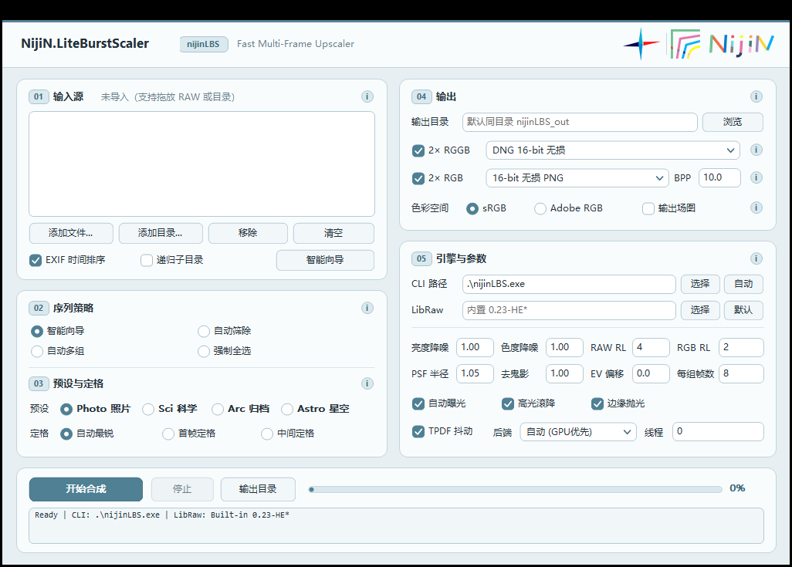

# NijiN.LiteBurstScaler (`nijinLBS`)

**Fast Multi-Frame 2× RAW & RGB Super-Resolution Upscaler** (`Metal` · `Vulkan` · `ARM64 NEON` · `x86_64 AVX2`)

`NijiN.LiteBurstScaler`（简称 **`nijinLBS`**）是一款零外部运行库依赖的跨平台相机多帧 **2× 超分辨率**合成引擎与原生轻量桌面端 GUI（macOS `AppKit` + Windows `Win32 GDI+`），专为高像素无低通机身（原生内置 `LibRaw 0.23-HE*`，开箱直读 **Nikon Z 8 / Z 9 高效压缩 HE / HE\*** 及主流相机 `.NEF / .DNG / .ARW / .CR3 / .RAF / .RW2`）打造。

<p align="center">
  
  
</p>

> 📖 **完整文档导航**：[**`ALGORITHM.md`（核心算法与物理场图技术文档）**](ALGORITHM.md) ｜ [**`CLI.md`（命令行全参数与收敛参考）**](CLI.md) ｜ [**`NOTICE.md`（第三方组件声明）**](NOTICE.md)

---

## 核心特性 / Key Features

- **零依赖跨平台 GPU + SIMD 加速（`--backend auto|gpu|cpu`）**
  - **macOS (`Metal`)**：原生调用 `Metal.framework` 统一内存零拷贝计算；
  - **Windows (`Vulkan`)**：内嵌 24 个预编译 Vulkan 1.0 `SPIR-V` 计算着色器，运行时动态加载显卡驱动自带 `vulkan-1.dll`（NVIDIA / AMD / Intel 通用，无需安装额外 SDK 或运行库）。在 `RTX 4080 SUPER` 上，7 张 45.7 MP Nikon Z 8 HE\* 合成 **1.83 亿像素（`16560×11040`）** 16-bit 无损 DNG 端到端总耗时约 **`9.0s`**（Stage 4+5 GPU 核耗时 **`1.9s`**）；
  - 无可用 GPU 环境自动无缝回退至纯 CPU `ARM64 NEON` / `x86_64 AVX2` 管线，三端输出 16-bit 一致性达 **`PSNR > 82 dB`**。
- **默认采用最高效 16-bit 数学无损压缩（并支持高级有损压缩与完整 EXIF/GPS 继承）**
  - **2× RGGB 线性 DNG 1.4**：默认 **`DNG 16-bit 无损`**（`SOF3` 2D 同相位预测，体积 **`0.39×`** / `~135 MiB`），可选高级有损压缩（`0.09×` / `~30 MiB`）、16-bit 半精度浮点 HDR（`0.29×`）与 16-bit 未压缩（`1.00×`）；
  - **2× 渲染 RGB（`sRGB` / 内嵌 ICC v2.4 `Adobe RGB`）**：默认 **`16-bit 无损 TIFF`**（字级 `Predictor=2` 水平差分 + 并行 `Deflate`，体积 **`0.39×`** / `~410 MiB`，在全 16-bit 无损格式中体积最小且编码最快），可选 16-bit 无损 PNG（`0.40×`）、14-bit **JPEG XS**（`.jxs` 高级有损 `0.21×` / 无损 `0.43×`，附 `--decode-jxs` 回转工具）与 16-bit 未压缩 TIFF（`1.00×`）。
- **四档场景预设（`Photo 照片` / `Sci 科学` / `Arc 归档` / `Astro 星空`）**
  - **`Photo`**：跨帧时域梯度相干保微纹理 + 三门控刚体微块超分 + 光学 PSF Richardson-Lucy 反卷积 + 自适应影调；
  - **`Sci`**：严格辐射度线性真值输出（关闭 PSF 反卷积、自动曝光、高光滚降与边缘抛光），适合科研测量与深度学习监督训练；
  - **`Arc`**：中性温和降噪与长期数字底片母版留存；
  - **`Astro`**：专为**免赤道仪、免脚架手持打星 / 手持星野**设计——跨通道拜耳邻域“防吞星”门控、恒星黑体与星云色彩保护、星点质心 6 项二阶多项式 + 天际线**天地双域独立对齐**、跨全感光度（`ISO 64–102400`）盖镜头黑场自动跳过，以及无黑环星形 RL 与夜空黑位锁定 `asinh` 柔和拉伸。
- **五维智能向导（CLI `--wizard` / GUI「智能向导」）**
  - 毫秒级识别「手持星野 / 纯星空 / AEB 包围曝光 / 三脚架稳态 / 局部动体 / 高感弱光」，给出亚像素象限覆盖评分、皇冠最锐帧与参数处方，支持一键采纳或任选第 `#1..N` 张作为运动/地景定格帧。

---

## 核心算法六步管线概览 / Core Algorithm Pipeline

`nijinLBS` 完全基于**光学采样几何与光子泊松-高斯统计建模**（零生成式脑补），通过六阶段管线将手持连拍亚像素微位移解混叠至 `2×` 网格（完整数学推导详见 [**`ALGORITHM.md`**](ALGORITHM.md)）：

1. **Stage 0 — 五维场景诊断与抗热噪分簇**：毫秒级读取 EXIF 时序分簇；在 `1/4` 尺度提取双绿次大值 `gq_2nd`，免疫高感热噪实现跨全感光度（`ISO 64–102400`）黑场过滤与针尖星点计数，选举无首帧快门震动的皇冠最锐参考帧。
2. **Stage 1 — 免黑图 `G1/G2` 盲暗电平与跨通道“防吞星”门控**：利用同光谱响应双绿分块中位数盲消通道偏置并守卫极暗部负偏；通过检验 `1×` 拜耳正交异色四邻域的光学艾里斑能量泄漏，精准区分单像素电路热噪与 1–2 像素微弱恒星，根除“吞星（Star Eater）”。
3. **Stage 2 — 盲泊松-高斯（Poisson-Gaussian）噪声自标定**：分亮度分位拟合读出噪声 $\sigma_0^2$ 与散粒噪声增益 $g$，结合跨帧时域差分二次校准，免疫有损压缩 RAW 机内空间平滑干扰。
4. **Stage 3 — 金字塔亚像素配准、天地双域对齐与防镂空去鬼影**：由粗到精 ZNCC 抛物面亚像素光流（`Astro` 模式下自动启用星点 6 项二阶多项式天球场 + 天际线地景双域独立配准）；经细/宽双尺度去鬼影、`1/4` 尺度形态学闭包填实纯色动体内部空洞，并通过**三门控刚体微块捞取**回收局部刚性平移目标的多帧亚像素样本。
5. **Stage 4 — 结构张量各向异性梅花阵双绿 + 残差 R/B 2× 重建**：在对齐导引图上分解结构张量构造沿边缘拉长、跨边缘收紧的自适应椭圆核，以抗差 M-estimator 聚合 `N` 帧 `G1/G2` 采样，并在白平衡色差域（$\Delta R, \Delta B$）无伪色重建 `2×` 全彩线性传感器图像。
6. **Stage 5 & 6 — 有理化 Anscombe GAT 多尺度维纳、对焦耦合 RL 与无损输出**：采用零浮点抵消的有理化 GAT 变换将异方差噪声归一化为单位高斯噪声，执行时域梯度相干保护的 **5 层滑动 `8×8` DCT 经验维纳收缩** + **6 层亮度引导 À-Trous 色度降噪** + **二阶拉普拉斯对焦场耦合防黑环 Richardson-Lucy 反卷积**（压制焦外散景锐化、消除亮星黑眼圈），最终封装为最高效无损 `SOF3` DNG 或字级差分 `Predictor=2` 无损 TIFF。

---

## 16-bit 物理场图指南 / Physical Field Maps

勾选 GUI **「输出场图」**（或 CLI 加 `--out-field <prefix>` / `--emit-field`）后，默认**分离导出三张与 `2×` 主图同尺寸、逐像素对齐的 16-bit 单通道无损灰度 PNG**（`0 = 纯黑`，`65535 = 纯白`），也可通过 `--field-mode`（或 GUI「输出场图」右侧下拉框）一键切换为 **合并单张 RGB** 或 **仅导出指定单张**：

| 默认灰度场图文件 | 承载物理量 | 灰度含义（`0 黑 -> 65535 白`） | 典型工程与后期用途 |
| :--- | :--- | :--- | :--- |
| **`*_field_motion.png`**<br>*(星野为 **`*_field_sky.png`**)* | **防镂空运动掩膜场**<br>*(星野模式为**天空/地景蒙版**)* | 常规模式：越白代表连拍中局部移动的人物/车辆/树叶，纯黑代表静态背景；<br>`Astro` 星野模式：越白代表星空天球域，纯黑代表地面山脊前景。 | 直接拖入 PS / Affinity 作为**调整图层黑白蒙版**，零手绘单独提亮运动人物，或单独拉高夜空银河曲线而丝毫不伤地面山脊。 |
| **`*_field_phase.png`** | **`2×2` 亚像素超分置信度** | 越白代表手持微抖动踩满 `2×2` 四相位象限且有效帧数充足（真 `2×` 解混叠含金量最高）。 | 在 `Sci 科学` 模式训练深度学习超分/去噪模型时直接作为单通道 `uint16` 像素级 Loss 权重，屏蔽动体退化伪真值。 |
| **`*_field_focus.png`** | **二阶拉普拉斯光学对焦场** | 越白代表处于镜头景深合焦面且具真实高频结构；`0` 代表焦外散景虚化或纯色区。 | 反相即得**纯焦外散景蒙版**，或直观检视镜头全开光圈下的场曲与跑焦落点。 |

- **模式切换选项（`--field-mode` / GUI 下拉框）**：`split`（**三张灰度，默认**）、`rgb`（合并单张 R/G/B 场图）、`motion`（仅运动/天空）、`phase`（仅超分相位）、`focus`（仅光学对焦）。详见 [**`ALGORITHM.md` 第 3 节**](ALGORITHM.md#3-16-bit-物理场图默认三张独立单通道灰度图详解与实战指南)。

---

## 快速上手 / Quick Start

### 1. 开箱即用（Releases 预编译包）
前往 [**Releases**](../../releases) 下载对应平台安装包：

- **macOS (Apple Silicon `arm64` — `.dmg` 镜像安装包)**：
  1. 双击打开 `nijinLBS-v1.6.4-macOS-arm64.dmg`，将 **`NijiN.LiteBurstScaler.app`** 拖入 **`Applications`（应用程序）**（内置完整 GUI 与 CLI，支持直接将 RAW 文件/目录拖到应用图标或窗口上）；
  2. **macOS 首次打开“解冻”（解除浏览器下载隔离属性 / Gatekeeper 拦截）**：由于应用采用本地 Ad-hoc 签名而未挂载付费 Apple Developer ID 公证，从浏览器下载首次打开若提示「已损坏，无法打开」或「无法验证开发者」，任选以下一种方式即可永久放行：
     - **方式 A（终端一行命令解冻，最快最彻底）**：打开「终端 (Terminal)」执行：
       ```bash
       sudo xattr -rd com.apple.quarantine /Applications/NijiN.LiteBurstScaler.app
       ```
       *(若放在其他目录，输入 `xattr -rd com.apple.quarantine ` 后将 `.app` 拖入终端回车即可；若单独下载 CLI 压缩包则执行 `xattr -rd com.apple.quarantine ./nijinLBS-v1.6.4-macOS-arm64-cli`)*
     - **方式 B（系统设置图形界面放行）**：首次点击打开被拦截后，进入 **「系统设置 → 隐私与安全性」**，滑到底部点击 **「仍要打开 (Open Anyway)」** 并确认。
  3. 终端直接调用内置 CLI：`/Applications/NijiN.LiteBurstScaler.app/Contents/MacOS/nijinLBS --help`（Releases 同时提供独立 CLI 压缩包）。
- **Windows (`x64`)**：解压 `nijinLBS-v1.6.4-Windows-x64.zip` 到任意目录，双击 **`nijinLBS_gui.exe`** 启动图形界面，或终端调用 `nijinLBS.exe`。
- **偏好自动记忆**：双端 GUI 自动记忆上次选择的 **RGGB / RGB 压缩格式、JPEG XS BPP、色彩空间、输出场图开关、序列策略、场景预设与微调参数**，下次启动即刻恢复。

### 2. 常用命令行示例
```bash
# 1) 日常手持连拍：默认同时输出最高效无损格式 —— 2x 16-bit 无损 DNG (0.39x) 与 16-bit 无损 TIFF (0.39x)
./nijinLBS --out-raw out_2x.dng --out-rgb out_2x.tif Z8S_8551.NEF Z8S_8552.NEF Z8S_8553.NEF Z8S_8554.NEF Z8S_8555.NEF Z8S_8556.NEF

# 2) 免脚架手持打星 / 星野：启动五维智能向导并导出三张独立 16-bit 灰度物理场图 (_sky / _phase / _focus.png)
./nijinLBS --wizard --out-raw astro_2x.dng --out-rgb astro_2x.tif --out-field astro_field Z8S_8787.NEF Z8S_8788.NEF Z8S_8789.NEF Z8S_8790.NEF Z8S_8791.NEF Z8S_8792.NEF

# 3) 整卡目录批量扫描：自动按 EXIF 时间分簇、跳过黑场、输出 Adobe RGB 14-bit JPEG XS
./nijinLBS --scan-dir /Volumes/NIKON_Z8/DCIM/116NCZ_8 --policy multi-group --out-dir ./sr_out --emit-rgb --rgb-format jxs --jxs-bpp 10.0 --color-space adobergb
```

完整参数表与收敛曲线详见 [**`CLI.md`**](CLI.md)，完整数学模型与场图 PyTorch/PS 示例详见 [**`ALGORITHM.md`**](ALGORITHM.md)。

---

## 从源码构建 / Building from Source

```bash
# 重新编译 24 个 Vulkan SPIR-V 计算着色器（仅修改 shaders/build_shaders.py 时需要，需 glslc）
python3 shaders/build_shaders.py

# 构建 macOS 原生 Metal CLI + Cocoa GUI（传入静态 LibRaw 与 SVT-JPEG-XS 目录）
make nijinLBS nijinLBS_gui LIBRAW_DIR=/path/to/libraw-heraw SVT_DIR=/path/to/svt-jpeg-xs

# 打包 macOS 原生 NijiN.LiteBurstScaler.app 与 .dmg 安装镜像
make dmg LIBRAW_DIR=/path/to/libraw-heraw SVT_DIR=/path/to/svt-jpeg-xs

# 交叉编译 Windows x64 静态 CLI + 现代 GDI+ Win32 GUI（需 mingw-w64）
make nijinLBS.exe nijinLBS_gui.exe LIBRAW_DIR=/path/to/libraw-heraw SVT_DIR=/path/to/svt-jpeg-xs
```

开源许可：本项目自有源码采用 [**Apache License 2.0 (`Apache-2.0`)**](LICENSE) 授权（允许自由商用与修改，须保留原作者署名、`LICENSE`、`NOTICE.md` 及修改说明）；预编译二进制涉及的第三方组件声明见 [**`NOTICE.md`**](NOTICE.md)。
