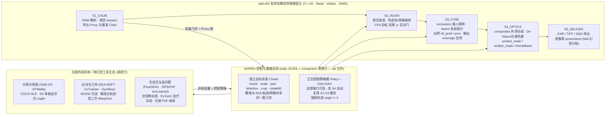

# `nijinLBS` 手持连拍光学效果边界（一级光谱色差 · 广义散景整形）与宿主中心型可扩展控制总线（`NOPB/1`）规范（Rev 2）

> **文档定位**：面向第二轮数学与系统架构复核（Astra Round-2 Audit）的完整修订规范。全文严格按 **「模型（Model）— 数学（Mathematics）— 算法（Algorithm）— 实现（Implementation）」** 四层展开，并与可运行参考实现 [`sdk/`](../sdk/README_ZH.md)（[`nib_v1.h`](../sdk/nib_v1.h)、[`nib_wire.py`](../sdk/nib_wire.py)、[`nijin_bus.py`](../sdk/nijin_bus.py)、[`test_interop.py`](../sdk/tests/test_interop.py) `13 passed`）逐项对齐。  
> **场景与产品务实边界（只纳入常规手持同焦点连拍真能落地的方案）**：
> 1. **三项硬排除**：全程**排除外部单目/三维深度模型、排除双像素 `DPRAW`（连拍带宽与缓存受限）、排除必须上架子的对焦包围栈（Focus Bracketing）**。一切设计与验收均建立在 **常规手持同焦点多帧 RAW 连拍** 之上。
> 2. **光学效果定位（`§1–§2`）**：不追求复刻特定台架镜片的全部三维像差，而是在手持同焦点连拍的场景线性 HDR 光子域中提供物理自洽、零振铃伪影的**相关一级光谱色差与广义散景整形**；已全量吸收[首轮复核](V3_OPTICS_SIDECAR_REVIEW_ZH.md)指出的正性基谱残差、大色散求积空档、离散圆盘弦长膨胀及前景边缘支持域归一化四项数学修正。
> 3. **可扩展控制接口定位（`§3–§4`，本轮重点纠偏）**：`nijinLBS` 内核严守 **100% 确定性物理数学模型、零内置幻觉、零下游工具名硬编码**；同时明确**主客体方向**——`nijinLBS` 是拥有 RAW 标定、亚像素配准、多帧超分、似然梯度与光学渲染能力的**有状态物理宿主**，外部五花八门乃至带强幻觉的工具（`SAM 2/3` 多候选浮点 Logits 与压缩 `RLE`、`SEA-RAFT/CoTracker` 流与稀疏轨迹、`Gyroflow` 防抖网格、`Flux/SDXL` 空洞修补、`PyTorch` `DPS/PnP` 采样、`lens-bench` 核库等）是**控制方与调用方**，无需改动 `nijinLBS` 即可低门槛读取物理中间态、绑定角色策略并调用其算力。

---

## §0 核心结论与首轮审查收敛矩阵（Executive & Delta Matrix）

| 模块 | 目标方向 | 手持连拍判定 | Rev 2 收敛后的数学与工程路径（含首轮审查闭环） | 明确排除的禁区与原因 |
| :--- | :--- | :---: | :--- | :--- |
| **§1 相关一级光谱色差** *(对照 `Hyperchromat` 色差镜)* | **1A. 三维轴向前后景极性反转散景 (`LoCA`)** | **否定（不做）** | — | 手持单焦点连拍无可靠全图有符号离焦深度，且裸镜圆盘散焦的 Bessel 零点 $J_1(R\omega)=0$ 已物理抹除异深单色高频锐核。 |
| | **1B. 连续光谱横向色散扇（径向色散 / 直视棱镜拉丝）** | **完全可行** | **曲率正则 NNLS 正基谱 + 残差直通差量形式 + 锚定 `555 nm` 的无空档自适应/分段求积**：既消除出锥饱和色的均匀场偏色与暗部负噪声截断偏置，又根治 `13` 点高斯求积在大位移下的 `3.063 px` 断档。 | 同色异谱核：三通道宽带 RAW 下单色 `580 nm` 钠灯与同色度红绿双峰 LED 同像，统一映射至曲率最小的光滑非负自然谱。 |
| | **1C. 合焦高光「刀锋锐核 + 双极光谱辉光」(`axial-aura`)** | **完全可行** | 显式保留直达干核 `c(x)`（100% 保住 `2×` 超分微结构），仅对高光抽出场按 `555 nm` 零锚点叠加双极无振铃圆盘散出减本地项（可选外部 `emitter_mask` 仅点亮真光源）。 | 全通道硬截顶且无未饱和裙边/短曝帧时，高光仅具亮度下界。 |
| **§2 广义散景控制** *(STF 及非 STF 散景族)* | **2A. 小光圈手持连拍「无中生有合成全身大虚化」** | **主体否定** *(仅修底层核)* | 定位并修复 [`heraw_suite_refocus.hpp#L560`](../heraw_suite_refocus.hpp#L560) `rp = r_f + 0.5f` 造成的子圆盘半径比例畸变（首轮离散 `-0.01596` 的精确病因）；改用**闭式条带面积原函数单弦长核 + `1.1461×` 二阶矩尺度匹配**，离散 $x\in[0,16]$ 最小实部压至 **`-0.000001`**，矩前缀表从 12 张减至 4 张。 | 手持微基线受二维角采样与抗混叠条件 $\nu_{\max}|\delta d|\le 1/2$ 双重限制，4–8 帧手抖无法凭空铺满大光圈入瞳。 |
| | **2B. 大光圈（`f/1.2–f/2.8`）实拍底片的「既有散景正向整形」** | **完全可行** *(手持主战场)* | 实拍已含真实三维渐进景深。对高置信散焦区（信噪门控 `wblur` 或外部 `protect_mask` 补集）施加**有效背景支持域归一化卷积 `G*(m·c) / G*m`**（零前景泄色）：① **`De-Nisen` 二线消除**（锁定 $k=0.45s$，原反相峰压低 `14.45×`，全局最深负峰压至 `-1.32%`）；② **切向旋焦 / 宽银幕竖椭圆 / 孤立光斑洋葱圈抑制**。 | **严禁反向增生高频的散景改造**（把已虚化圆盘逆滤波成皂泡亮环、折返环或硬多边形必在 $J_1$ 零环引爆噪声）。 |
| **§3–§4 宿主中心型控制总线 (`NOPB/1`)** | **不改 `nijinLBS` 即可让乱七八糟/带幻觉的外部工具直接用其能力** | **核心架构** *(本轮重构)* | 纠正首轮「无状态文件打包 + Python 玩具算子插件」偏差： ① **宿主建会话并导出参考图与原生 `Chart`**（调用方零猜尺寸、链式构造变换、零手推矩阵）； ② **`Chart` 与数据形态解耦**：4D 栅格、`5D` 多候选 Logits、COCO `RLE`、框点、稀疏轨迹、`WarpGrid` 共享同一套防黑边坐标映射； ③ **数据名词与控制策略动词分离**（`align` / `fuse.exclusions & layers` / `optics.composites & masks`）+ 可选端口 + **跨切面增量 Dirty-DAG**； ④ **有状态常驻会话 + `mmap/shm` 零拷贝 + 严格 `origin != 0` 幻觉溯源门禁**。 | 外部调用方严禁伪造 `origin = 0 (nijin_measured)`；凡混入 `generative_prior` 权重的像素在 EXR `provenance` 中强制打上 `bit4 (0x10)`。 |

---

## §1 相关一级光谱色差效果：正性差量传输与无空档光谱求积

### 1.1 模型（Physical Essence）

对照工作区先期超色差镜工程 [`artifacts/hyperchromat-lensbench`](../../../artifacts/hyperchromat-lensbench)（Schott `N-SK16 / N-F2` 零光焦度胶合组），其在场景线性 HDR 域区别于廉价后期「红蓝通道平移」的核心物理机制有三点：
1. **连续波长积分消除三通道断层黑缝**：沿 $[410, 680]\text{ nm}$ 连续色散铺展光谱扇，而非红绿蓝三根孤立亮线；
2. **燧石玻璃短波非线性陡峭度**：由 `N-SK16 / N-F2` 精确 Sellmeier 系数复算，材料折射率差比 $|\Delta n_g - \Delta n_e| / |\Delta n_C - \Delta n_e| = \mathbf{2.2575}$；若以视觉峰值 $\lambda_0 = 555\text{ nm}$ 为零位移锚点并以 $g\text{-}C$ 跨度归一化：
   $$\psi(\lambda) = \frac{\Delta n(\lambda) - \Delta n(555\text{ nm})}{\Delta n(435.84\text{ nm}) - \Delta n(656.27\text{ nm})}$$
   则 $\psi(435.84\text{ nm}) = +0.72683$、$\psi(656.27\text{ nm}) = -0.27317$，短长波相对锚点跨度比达 **`2.6607`**，近七成色散集中在紫—钴蓝—冰青—绿段；
3. **未截顶场景线性光子驱动**：在色调滚降之前，高光数倍于漫射白的真实通量向邻域色散展开，形成自然发光边缘。

---

### 1.2 数学（Residual-Passthrough Choquet Transport & Gap-Free Quadrature）

#### 1. 曲率正则正基谱与残差直通差量方程（解决锥外顶点偏色与暗噪声截断偏置）

设工作线性空间（相机标定线性空间或 `Rec.2020 / sRGB` 线性空间，反射率模式下含标准照明权重）在求积节点 $\lambda_q$ 处的三刺激合成矩阵为 $\mathbf{T} = [\mathbf{t}_1, \dots, \mathbf{t}_Q] \in \mathbb{R}^{3\times Q}$。首轮复核指出两个关键事实：
- 传感器光谱响应存在重叠，转入线性显示基后目标单纯形顶点（如 $(1,0,0)^\top$）未必严格落在非负物理谱锥 $\{\mathbf{T}\mathbf{s} : \mathbf{s} \ge \mathbf{0}\}$ 内；
- 若简单将带噪线性像素拆为 $\mathbf{c}_+ = \max(\mathbf{c}, 0)$ 与 $\mathbf{c}_- = \min(\mathbf{c}, 0)$ 并只重构 $\mathbf{T}\hat{\mathbf{s}}(\mathbf{c}_+)$，对暗部零均值高斯噪声 $n \sim \mathcal{N}(0, \sigma^2)$ 会引入截断偏置 $\mathbb{E}[\min(n, 0)] = -\sigma / \sqrt{2\pi}$，且锥外饱和色在均匀场会产生拟合残差偏色。

**修正定理 1.1（残差直通的正性 Choquet 光谱差量算子）**：
1. **离线曲率惩罚 NNLS 基谱**：对 7 个 RGB 单纯形非零顶点 $\mathbf{e}_k \in \{W, C, M, Y, R, G, B\}$，离线求解二阶差分曲率正则非负最小二乘：
   $$S_k = \arg\min_{\mathbf{s} \in \mathbb{R}_{\ge 0}^Q} \|\mathbf{T}\mathbf{s} - \mathbf{e}_k\|_2^2 + \mu \|\mathbf{D}_2 \mathbf{s}\|_2^2$$
   并公开记录各色彩空间顶点的复投影残差 $\|\mathbf{T}S_k - \mathbf{e}_k\|_2$。
2. **Lovász 单纯形非负升维**：对源辐射场 $\mathbf{c}_+ = \max(\mathbf{c}, 0)$（或高光门控场 $\mathbf{c}_{\text{hi}}$），排序 $0 \le c_{\min} \le c_{\text{mid}} \le c_{\max}$ 得第 $q$ 波段非负标量谱 $\hat{s}_q(\mathbf{c}_+) = c_{\min} S_W(\lambda_q) + (c_{\text{mid}} - c_{\min}) S_{\text{sec}}(\lambda_q) + (c_{\max} - c_{\text{mid}}) S_{\text{pri}}(\lambda_q) \ge 0$。
3. **残差直通差量渲染（Residual-Passthrough Delta Form）**：对每波段施加保常数空间算子 $\mathcal{K}_{\lambda_q}$（满足 $\mathcal{K}_{\lambda_q}[1] = 1$），输出定义为：
   $$\mathbf{c}_{\text{render}}(\mathbf{x}) = \mathbf{c}(\mathbf{x}) + \sum_{q=1}^Q \mathbf{t}_q \left(\mathcal{K}_{\lambda_q}[\hat{s}_q](\mathbf{x}) - \hat{s}_q(\mathbf{x})\right)$$
   **四条严格性质**：
   - **零强度逐位恒等**：当 $\mathcal{K}_{\lambda_q} = \mathcal{I}$ 时，$\mathbf{c}_{\text{render}}(\mathbf{x}) \equiv \mathbf{c}(\mathbf{x})$ 逐位全等；
   - **任意均匀场绝对零偏色**：对任意空间常值像素（含锥外极饱和色与带负值暗噪声），因 $\mathcal{K}_{\lambda_q}[\hat{s}_q] = \hat{s}_q$，差量项恒为 `0`，输出精确等于输入 $\mathbf{c}$；
   - **暗部有符号统计零偏置**：无梯度暗区的零均值噪声经首项 $\mathbf{c}(\mathbf{x})$ 无损保留，不触发 $-\sigma/\sqrt{2\pi}$ 截断均值漂移；
   - **径向约定明确化**：径向横向色散明确采用**保表面亮度的拉回采样（Surface-Brightness Pullback）** $\mathcal{K}_{\lambda_q}[\hat{s}_q](\mathbf{x}) = \hat{s}_q(\mathbf{x} - \Delta\mathbf{x}_q(\mathbf{x}))$，确保均匀天空在径向色散下表面亮度恒定（不乘推前雅可比行列式）。

#### 2. 锚定 `555 nm` 的无空档自适应/分段光谱求积（消除 `3.063 px` 采样断裂）

标准 `13` 点 Gauss-Legendre 在 $[410, 680]\text{ nm}$ 上的中心节点为 `545 nm`（偏离 `555 nm` 零锚点），且当最大色散位移 $\kappa_{\max} = 16\text{ px}$ 时相邻波段位移间距达 **`3.063 px`**，导致 `1 px` 细脉冲在线性插值下于整数位置 $x = 4, 7, 10, 13$ 跌落为零。

**求积准则**：
- 将积分区间在锚点处显式拆分为 $[410, 555]\text{ nm} \cup [555, 680]\text{ nm}$，并把 $\lambda_0 = 555\text{ nm}$（$\psi = 0$）设为显式节点；
- 对横向色散 `spectral-lateral`，按当前画幅最大位移跨度 $D_{\max} = \max_{\mathbf{x}} \|\Delta\mathbf{x}(410\text{ nm}) - \Delta\mathbf{x}(680\text{ nm})\|$ 动态选取子区间分段数 $Q = \max\!\left(15,\; \lceil D_{\max} / 0.60 \rceil\right)$（或对每个子波段 $[\lambda_{q-1/2}, \lambda_{q+1/2}]$ 沿位移线段做一维盒式线积分），保证任意相邻波段足迹重叠间距 $\le 0.60\text{ px}$，细线剖面连续无空档；
- 对合焦辉光 `spectral-axial-aura`，显式保留 `100%` 直达锐核并对高光提取场 $\hat{s}_q^{\text{hi}}$（可与外部 `emitter_mask` 相乘以保护白衣与文字）施加下节无振铃三圆盘散出：
  $$\mathbf{c}_{\text{render}}(\mathbf{x}) = \mathbf{c}(\mathbf{x}) + \gamma_{\text{aura}} \sum_{q: R_q > 0} \mathbf{t}_q \left(P_{R_q}^{\text{3-disc}} * \hat{s}_q^{\text{hi}} - \hat{s}_q^{\text{hi}}\right)(\mathbf{x}), \qquad R_q = R_{\max}|\psi(\lambda_q)|$$

---

## §2 广义散景控制：离散三圆盘闭式修正与实拍散景支持域整形

### 2.1 现有重对焦底层核的精确病因定位与闭式条带修正（`OP-O2`）

1. **为什么手持小光圈连拍不主打「凭空造大虚化」**：
   对手持轨迹上的最高保留频率 $\nu_{\max}$（cycles/px），相邻视点在目标离焦平面上的残差视差须满足抗混叠条件 $\nu_{\max}|\delta d| \le 1/2$ 且二维角分布需铺满目标入瞳面积。常规 4–8 帧手抖（`< 1.5 mm`）既缺视差宽度也缺二维角覆盖，故小光圈造大虚化不作为手持主力方向。
2. **首轮离散反例 `-0.0159551` 的代码级根因与闭式单弦长修复**：
   在连续解析域中，三圆盘正权基 $(\alpha_1, \alpha_2, \alpha_3) = (0.28, 0.58, 1.00)$、$(w_1, w_2, w_3) = (0.220, 0.406, 0.374)$ 在 $x = R|\omega| \in [0, 16]$ 的最低带符号 OTF 为 **`-0.00008645`**（全 Nyquist 域最低处在 $x = 18.8318$ 为 **`-0.04620`**，$R=32$ 时约 `0.0937 cycles/px`；空间二阶矩 $4\operatorname{Var}(x)/R^2 = 0.52783$，相对旧 `Poly2` 核 `0.69333` 的等效 RMS 半径缩放比为 $\sqrt{0.69333 / 0.52783} = \mathbf{1.1461}$）。  
   首轮复核实测 [`heraw_suite_refocus.hpp#L560`](../heraw_suite_refocus.hpp#L560) 在 $R=32, x=16$ 处出现水平 **`-0.0159551`** 的偏差——经逐行复算，其**精确代码根因**是第 560 行写了 `const float rp = r_f + 0.5f;`（而第 581 行像素边界交集已自带 `1.0 px` 宽度积分），导致每个子圆盘被额外加上固定常数 `+0.5 px`，三圆盘半径比从 `(0.2800 : 0.5800 : 1.0000)` 畸变为 `(0.2911 : 0.5865 : 1.0000)`！  
   **闭式修正方案**：去掉错误的 `+0.5f` 半径膨胀，对每行像素条带 $y \in [y_0, y_1] = [\max(-R, \Delta y - \tfrac{1}{2}),\; \min(R, \Delta y + \tfrac{1}{2})]$ 直接用圆面积原函数计算精确条带面积与等效半弦长：
   $$F_R(u) = \frac{1}{2}\!\left(u\sqrt{R^2 - u^2} + R^2 \arcsin\!\frac{u}{R}\right), \qquad A_{\text{strip}} = 2\big(F_R(y_1) - F_R(y_0)\big), \qquad w_y = y_1 - y_0, \qquad e_x = \frac{A_{\text{strip}}}{2 w_y}$$
   实测在 $R = 32\text{ px}$ 下，每圆盘每行仍仅需 **1 次零阶前缀表查询**（整圆代价为 $O(R)$ 条弦查询，矩前缀数组从 12 张减至 4 张，省去该组缓冲 `2/3`），离散 $x \in [0, 16]$ 三方向最低 OTF 立即恢复为：水平 **`+0.000633`**、竖直 **`-0.000001`**、对角 **`+0.000206`**（全 Nyquist 域最低 `-0.04569` 位于 $x = 18.82$），彻底消除离散弦长失配。环形核 $(1+\eta)P_R - \eta P_{\alpha R}$ 同理严格约束在 $0 \le \eta \le \alpha^2/(1-\alpha^2)$ 非负域内。

---

### 2.2 手持大光圈实拍底片（`f/1.2–f/2.8`）的正向散景整形（`OP-O3`）

实拍大光圈 RAW 已内含真实三维景深过渡 $Y = P_R * X + n$，痛点是硬圆盘传递函数 $D(x) = 2J_1(x)/x$ 在 $x = 5.13562$ 处高达 **`-0.13228`** 的反相负峰（二线散景病因）。在严禁反向逆滤波增生高频的前提下，落地三项正向算子：

1. **锁定强度映射的 `De-Nisen` 二线消除**：
   用户强度 $s \in [0, 1]$ 严格映射为线性核比例 $k(s) = 0.45\,s$，追加高斯平滑 $\sigma_{\text{add}}(\mathbf{x}) = k(s)\,\hat{R}(\mathbf{x})$，合成频响为 $H_{\text{add}}(x) = D(x)e^{-(k(s)x)^2/2}$：
   - 当 $s = 1.0$（$k = 0.45$）时，原负峰 $x = 5.13562$ 幅度降至 **`-0.009157`（缩小 `14.45×`）**，乘积全局新负峰移至 $x = 4.51177$ 处，幅度为 **`-0.013219`（全局最坏反相旁瓣缩小 `10.01×`）**，二阶矩等效半径温和变为 $\sqrt{1 + 4k^2}R = 1.345R$；
   - 当 $s = 0.85$（$k = 0.3825$）时，$x = 5.13562$ 处降至 `-0.01920`（缩小 `6.89×`）。
2. **有效背景支持域归一化（根绝前景边缘泄色）与散焦置信度门控**：
   - 原生 `wblur` 属于纹理相关散焦代理（纯色天空/白墙无梯度证据），故仅在边缘/高光信噪达标处提取 $(\hat{R}, \text{conf})$ 并沿颜色亲和度向邻域扩散，低证据区自动保守衰减；若外部通过 `NOPB` 提供了前景掩膜（如 `SAM` RLE/Logits），则前景保护内恒取背景权重 $m_{\text{bg}}(\mathbf{x}) = 0$。
   - 为彻底杜绝前景亮/暗像素跨边界渗入散景或散景反渗入前景，对焦外层执行**支持域归一化卷积**：
     $$\tilde{\mathbf{c}}_{\text{bg}}(\mathbf{x}) = \frac{\big(G_{\sigma(\mathbf{x})} * (m_{\text{bg}}\,\mathbf{c})\big)(\mathbf{x})}{\max\!\big((G_{\sigma(\mathbf{x})} * m_{\text{bg}})(\mathbf{x}),\;\epsilon\big)}, \qquad \mathbf{c}_{\text{out}}(\mathbf{x}) = \big(1 - m_{\text{bg}}(\mathbf{x})\big)\mathbf{c}(\mathbf{x}) + m_{\text{bg}}(\mathbf{x})\,\tilde{\mathbf{c}}_{\text{bg}}(\mathbf{x})$$
     当局部有效背景覆盖 $(G_\sigma * m_{\text{bg}})(\mathbf{x}) < \tau_{\text{sup}}$ 时平滑回退至原像素 $\mathbf{c}(\mathbf{x})$；主体核心区 $m_{\text{bg}} = 0$ 逐位保持恒等（`MTF50` 零损失）。
3. **切向旋焦、宽银幕椭圆拉伸与孤立光斑洋葱圈抚平**：
   同样在支持域归一化框架下，沿画幅切向单位矢 $\hat{\mathbf{e}}_\theta(\mathbf{x})$ 或竖轴施加离轴递增正向核塑造旋焦/变形宽银幕散景；对检出的孤立圆光斑内部（或外部指定选区）做径向同心高频带阻平滑以消除非球面研磨纹，不触碰真实物体纹理。

---

## §3 宿主中心型可扩展控制架构（`NOPB/1`）：让乱七八糟的外部工具直接用 `nijinLBS` 的能力

### 3.1 模型：纠正「通用插件玩具」偏差，确立「确定性物理宿主 ← 任意异构控制方」架构

首轮 SDK 原型存在一个根本方向偏差：把接口做成了对称的「无状态 `.nib` 文件打包 + 在 Python 里注册固定端口算子」，导致外部脚本既拿不到 `nijinLBS` 解码后的活动区几何与对齐预览图，也无法表达同一画面中多张掩膜的不同控制意图，更把非四维栅格（`RLE`、多候选 Logits、稀疏轨迹）的空间坐标系锁死了。

Rev 2 确立严格不对称的三层协同模型：
1. **`nijinLBS` 有状态物理宿主（Host）**：独占 RAW 解码标定（`S1_CALIB`）、亚像素配准与 CFA 残差 $\chi^2$ 评估（`S2_ALIGN`）、多帧/多图层超分融合（`S3_FUSE`）、物理似然梯度/近端算子（`nll_grad / prox`）、场景线性光学整形（`S4_OPTICS`）及溯源导出（`S5_DELIVER`）。**内核不写任何外部工具逻辑，只暴露正交数学控制槽。**
2. **独立坐标系注册表 `Chart` + 外围脏数据适配层（SDK Adapters）**：宿主在打开 RAW 时生成权威 `session` 与基准 `Chart("active_1x")` 并导出参考预览图；外围 SDK 将外部五花八门的数据形态（`SAM` 多候选 `[T,M,K,H,W]` Logits、COCO 压缩 `RLE`、`PyTorch` `NCHW` 光流、`CoTracker` 稀疏点轨迹、`WarpGrid`、`Flux` 补洞图）统一绑定到链式派生的 `Chart` 上，C++ 内核无需感知下游格式碎片。
3. **控制策略动词（`Policy`）与跨切面增量重算（Dirty-DAG）**：将数据字段（名词）与控制意图（动词）解耦，支持可选覆盖与常驻会话增量重算。

---

### 3.2 数学：解绑数据形态与几何变换的 `Chart` 代数及多策略耦合方程

#### 1. 像素边界坐标系 `Chart` 的链式闭合代数（零手推矩阵，通吃栅格与非栅格）

定义 `active_1x` 为传感器去黑边后的原生像素边界坐标系：第 $(i, j)$ 像元占据 $[i, i+1) \times [j, j+1)$，中心为 $(i + \tfrac{1}{2}, j + \tfrac{1}{2})$。任意外部坐标系 $C = (\mathbf{A}_C, \mathbf{b}_C, B_C, (W_C, H_C))$ 记录从外部像素边界坐标 $\mathbf{u} = (u, v)^\top$ 到 `active_1x` 的可逆仿射变换 $T_C(\mathbf{u}) = \mathbf{A}_C \mathbf{u} + \mathbf{b}_C$ 及未补边有效域半开盒 $B_C = [u_0, u_1) \times [v_0, v_1)$（保留精确浮点边界 $B_C \subset \mathbb{R}^4$ 以支持非整除缩放如 `.scale(0.25)`）。

当外部预处理对图像施加正变换 $\mathbf{u}' = M(\mathbf{u})$ 时，派生坐标系严格按 $T_{C'} = T_C \circ M^{-1}$ 自动复合（已在 [`nijin_bus.py`](../sdk/nijin_bus.py#L148-L250) 实现）：
- **缩放 / 重采样 `scale(s_x, s_y)`**：$\mathbf{A}_{C'} = \mathbf{A}_C \operatorname{diag}(s_x^{-1}, s_y^{-1})$，$\mathbf{b}_{C'} = \mathbf{b}_C$，$B_{C'} = [s_x u_0, s_x u_1) \times [s_y v_0, s_y v_1)$；
- **任意补边 `pad(l, t, r, b)` 与 `letterbox(1024)`**：$\mathbf{A}_{C'} = \mathbf{A}_C$，$\mathbf{b}_{C'} = \mathbf{b}_C - \mathbf{A}_C (l, t)^\top$，$B_{C'} = [u_0 + l, u_1 + l) \times [v_0 + t, v_1 + t)$（右/底补零区严格落在 $B_{C'}$ 之外！）；
- **裁剪 `crop(c_{x0}, c_{y0}, c_{x1}, c_{y1})`**：$\mathbf{b}_{C'} = \mathbf{b}_C + \mathbf{A}_C (c_{x0}, c_{y0})^\top$，有效盒取交集平移；
- **正交旋转 `rotate90(k=1)`（顺时针 $90^\circ$，$u' = H_C - v,\; v' = u$）**：
  $$T_{C'}(u', v') = T_C(v', H_C - u') \implies \mathbf{A}_{C'} = \begin{bmatrix}-a_{01} & a_{00}\\ -a_{11} & a_{10}\end{bmatrix},\quad \mathbf{b}_{C'} = \mathbf{b}_C + H_C\begin{bmatrix}a_{01}\\ a_{11}\end{bmatrix},\quad B_{C'} = [H_C - v_1, H_C - v_0) \times [u_0, u_1)$$

**四类物理量的统一换基法则（`BUS-O1`）**：
- **标量与缺测判定**：反解 $\mathbf{u} = \mathbf{A}_C^{-1}(\mathbf{x}_{\text{act}} - \mathbf{b}_C)$。若 $\mathbf{u} \notin B_C$，直接返回 `missing`（保留真实局部裁剪的未测量语义）；**仅当 $\mathbf{u} \in B_C$ 时**将双线性插值中心钳制在 $[\min(u_0 + \tfrac{1}{2}, \bar{u}),\; \max(u_1 - \tfrac{1}{2}, \bar{u})] \times [\min(v_0 + \tfrac{1}{2}, \bar{v}),\; \max(v_1 - \tfrac{1}{2}, \bar{v})]$，彻底阻断 `SAM` 补零黑边向画面渗漏；
- **跨帧有限位移（双图公式）**：源帧坐标图 $C_s$ 上的 $\mathbf{u}$ 指向目标帧坐标图 $C_t$ 上的 $\mathbf{u} + \Delta\mathbf{u}$，活动区位移严格为 $\Delta\mathbf{x}_{\text{act}} = T_{C_t}(\mathbf{u} + \Delta\mathbf{u}) - T_{C_s}(\mathbf{u})$（仅当 $T_{C_t} = T_{C_s}$ 时退化为 $\mathbf{A}_{C_s}\Delta\mathbf{u}$）；
- **二维协方差推前**：$\Sigma_{\text{act}} = \mathbf{A}_C \Sigma_{\text{ext}} \mathbf{A}_C^\top$；
- **非栅格空间对象共享 `Chart`**：`COCO RLE` 游程掩膜、`5D` 多候选 Logits、`CoTracker` 稀疏点轨迹 `[T, P, 2]` 与双三次 `WarpGrid [N, Gh, Gw, 2]` 在 `kind = 3 (NIB1_ND)` 下同样携带 `chart_id` 与镜像 `affine / bbox`，消除首轮「非四维张量丢失仿射矩阵」的限制。

#### 2. 四组正交控制策略槽（解决多掩膜语义冲突与空间耦合边界）

| 控制槽 | 数学作用算子（不传时 100% 退回 `nijinLBS` 默认路径） | 典型外部玩法映射（内核零硬编码） |
| :--- | :--- | :--- |
| **`policy.align`** (`S2_ALIGN`) | 对外部候选流/稀疏轨迹/`WarpGrid` $\tilde{\mathbf{v}}_k$ 计算原生 CFA 泊松-高斯马氏残差 $d_{\chi^2}^2(\mathbf{x})$；`chi2_gated` 模式下超限处自动回退/降权，拒绝外部光流在遮挡区的幻觉错配。 | `SEA-RAFT` 大位移光流、`CoTracker` 轨迹引导、`Gyroflow` 手持卷帘防抖。 |
| **`policy.fuse`** (`S3_FUSE`) | ① `exclusions`：将指定帧集 $F_e$ 在掩膜区内的观测权重置零，由其余帧重建背景并输出真实覆盖计数 $C(\mathbf{x})$（$C(\mathbf{x})=0$ 即精确死角空洞）； ② `layers[0..L-1]`：按每层掩膜/软 Logit 与运动场独立解算线性超分辐射 $\hat{X}_\ell$、后验噪声 $\hat{\sigma}_\ell$ 与覆盖图 $C_\ell$。 | `SAM 2` + `Flux` 无痕路人剔除与空洞定位、多运动主体同步 `2×` 超分、主体锁定虚拟摇拍。 |
| **`physics.nll_grad` & `prox`** (`S3` 常驻算子) | 对驻留 RAW 返回冻结方差/可见性下的精确目标值与伴随梯度 $(\mathcal{L}_{\text{RAW}}(X), \nabla_X \mathcal{L}_{\text{RAW}}(X))$，或近端解 $\arg\min_X \mathcal{L}_{\text{RAW}}(X) + \tfrac{1}{2}\|X - Z\|_\Lambda^2$（显式声明作用域：空间耦合正则会向邻域传播影响，需位级不变的 ROI 须设为硬冻结边界 `BUS-O3`）。 | `PyTorch` 扩散后验采样（`DPS`）、`PnP-ADMM` 物理保真引导。 |
| **`policy.optics`** (`S4_OPTICS`) | ① `composites`：在线性域按权重与可选 `protect_mask` 融合外部先验图 $Z$（`origin=4` 处强制置位 `provenance bit4 = 0x10`）； ② `protect_mask` / `emitter_mask` / `kernel_bank`：分别控制散景主体恒等门、合焦辉光发光体选区与外部空间/光谱变化 PSF 核库。 | `Flux/LaMa` 空洞线性回填、`SAM` 主体保护 `De-Nisen` 散景、霓虹灯选区色差辉光、`lens-bench` 自定义核渲染。 |

---

## §4 实现规范：冻结线协议 `nib_v1.h`、有状态双模服务与跨切面 Dirty-DAG

### 4.1 字节级冻结布局（[`sdk/nib_v1.h`](../sdk/nib_v1.h) 与 [`sdk/nib_wire.py`](../sdk/nib_wire.py)）

完整保留首轮校对通过的小端字节偏移布局（无宿主编译器结构体填充歧义）：
- **Header（固定 `64 B`，`<8s6I4Q`）**：`0..7` 魔数 `NIJBUS01`；`8,12,16,20,24,28` 为版本 `1`、阶段、帧数、`active_w`、`active_h`、字段数；`32` 为 `session` 的 `FNV-1a 64` 快速锁；`40,48` 为 UTF-8 JSON manifest 偏移与字节数；`56` 为描述符目录偏移（固定 `64`）。
- **Descriptor（固定 `128 B`，`<40s4H2i4I6f4I2Q`）**：`0..39` 为零结尾 ASCII 短键（超 39 字节或含 Unicode 的字段名自动映射为 `"id." + sha256[:36]` 并在 manifest 保存 `public_name`）；`40,42,44,46` 为 `dtype`、`kind`（`0=SCALAR, 1=VECTOR, 2=COV2, 3=ND`）、`origin`（`0..4`）、`codec`；`48,52` 为有符号 `frame / layer`；`56..71` 为 `u32 shape[4]`；`72..95` 为 `f32 affine[6]`；`96..111` 为 `u32 bbox[4]`；`112,120` 为 `64 B` 对齐的连续小端 payload 偏移与字节长度。
- **认知来源与像素溯源硬门禁**：
  - `NIB1_ORIG_NIJIN_MEASURED = 0` **仅允许 `nijinLBS` 宿主内部导出场写入**；外部调用方在 SDK 或 `attach` 中声明 `origin = 0` 直接报错拒绝；
  - 外部输入分属 `1 = co_calibrated`、`2 = testable_geom`、`3 = partition_mask`、`4 = generative_prior`；凡 `origin = 4` 以非零权重参与像素合成或近端求解，对应输出像素的 `provenance` 位掩码强制打上 `NIB1_PROV_GENERATIVE = 0x10 (bit4)`。
- **字段交换包与完整检查点的严格区分（`BUS-O4`）**：普通 `.nib` 为逻辑切面字段/策略交换包；若需跨进程同后端逐位等价续跑（`--stop-at` / `--resume-from`），检查点须保持未量化 `FP32/FP64` 内部状态与相同后端归约配置（有状态常驻会话在内存内天然保持未量化状态零损失）。

### 4.2 有状态双模控制面与主程序 CLI 原语

1. **常驻会话与零拷贝交互模式（`nijinLBS --bus-serve` + Python `NijinClient`）**：
   - `open_session`：加载连拍 RAW 驻留内存/显存，返回 `session_handle`、权威 `session` 与 `proxy_rgb`；
   - `attach`：跨切面挂载外部张量、`Chart` 与 `policy`，按 `S1 -> S2 -> S3 -> S4 -> S5` 依赖图自动计算 `cached_stages` 与 `invalidated_stages`（例如修改 `S4_OPTICS` 掩膜或散景参数时，`S1..S3` 保持缓存不重算）；
   - `call` / `export` / `close_session`：在常驻会话上调用物理算子或推进切面，读取端通过 `FileSlice / mmap` 零拷贝映射为只读 `NumPy` 视图。
2. **离线批处理与原生光学 CLI 原语**：
   - 总线：`--bus-export <out.nib> [--stop-at S1|S2|S3|S4]` · `--bus-in <ext.nib>`（支持单包跨切面注入策略与张量）；
   - 光谱色差：`--spectral-ca <off|lateral|axial-aura>` · `--spectral-ca-power <float>` · `--spectral-ca-angle <radial|deg>`；
   - 散景整形：`--bokeh-de-nisen <0..1>` · `--bokeh-swirl <-1..1>` · `--bokeh-aspect <1.0..2.0>` · `--bokeh-onion-clean <0..1>`。

---

## §5 可证伪数学与系统验收总表（Rev 2 Oracles）

| 编号 | 审查模块 | 可证伪测试构造（含首轮反例回归） | 定量通过判据（Pass Criterion） |
| :--- | :--- | :--- | :--- |
| **`OP-O1`** | **残差直通正基谱与无空档求积** | ① 含锥外极饱和色与零均值暗噪声 $\mathcal{N}(0,\sigma^2)$ 的均匀色卡施加 `spectral-lateral / axial-aura`； ② 对 `1 px` 白线施加 `16 px` 横向色散（对比 `13` 点 Gauss-Legendre 在 $x=4,7,10,13$ 的零空档反例）。 | ① 效果为 `0` 时逐位恒等；任意均匀场偏色误差 `< 10^{-7}`，暗区均值无 $-\sigma/\sqrt{2\pi}$ 漂移；非负输入下边缘零负过冲； ② `1 px` 细线在色散足迹内严格连续正值无断档，`555 nm` 锚点两端位移跨度比吻合 `2.6607`。 |
| **`OP-O2`** | **闭式条带面积单弦长三圆盘 STF** | 在 `151×151` 脉冲、`R=32 px` 上实跑离散三圆盘 `(0.28, 0.58, 1.00)`，测量水平/竖直/对角余弦 OTF 及二阶矩尺度。 | 修复 `rp = r_f + 0.5f` 后，离散核在 $x \in [0, 16]$ 三方向最小实部 `> -0.0005`（实测竖直 `-0.000001`，消除首轮 `-0.01596` 误差）；全 Nyquist 最低处位于 $x \approx 18.82$（`> -0.047`）；矩前缀缓冲从 12 张减至 4 张。 |
| **`OP-O3`** | **支持域归一化 `De-Nisen` 与前景零泄色** | ① 正弦与指定线距/对比度的双线散景底图（$R=14\text{ px}$），测 $s=1.0\;(k=0.45)$ 与 $s=0.85$； ② 高反差合焦主体边界 + 焦外背景，测支持域归一化 `G*(m·c)/G*m`。 | ① $s=1.0$ 时 $x=5.1356$ 反相幅值缩小 `14.45×`（`-0.00916`），全局负峰 $x=4.5118$ 为 `-0.01322`（缩小 `10.01×`）； ② 保护掩膜内像素误差严格为 `0`（`MTF50` 衰减 `0%`），跨边界零前景泄色。 |
| **`BUS-O1`** | **`Chart` 链式代数与非栅格空间映射** | 竖拍 `(600,800)` 经 `rotate90(1).letterbox(1024).scale(0.25)` 生成 `SAM` `256×256` Logits、COCO `RLE`、`NCHW` 光流与双图不同仿射流 $(1,2)$。 | 框外返回 `missing`（`None`），框内边界夹紧至 `0.5 / 191.5` 零黑边渗漏；双图位移精确得 `(14, -7)`；`90°` 协方差对角交换得 `(9, 0, 4)`；`RLE` 与稀疏点表在 C++20 `nib_v1.h` 下逐字节还原（已由 `test_interop.py` 验证）。 |
| **`BUS-O2`** | **驻留物理似然梯度与传输预算** | 在含 Bayer/X-Trans、OLPF、`Q4/Q5` 的 4 帧实样上，以 `FP64` 多步长方向差分检验 `nll_grad`（近零导数用绝对误差，大数相减用局部损失差），并分报内核计算耗时与主机/共享内存搬运耗时。 | 伴随内积与方向差分在各 CFA/饱和边界一致；明确记录 `frozen_noise`、`objective_id`、ROI 与驻留内存带宽。 |
| **`BUS-O3`** | **多掩膜角色策略、近端耦合边界与幻觉溯源** | 同一会话挂载路人剔除、主体保护、生成式补洞（`origin=4`）与 `diagonal_gls_prox`；同时验证外部伪造 `origin=0`。 | 伪造 `origin=0` 立即抛错拦截；保护区内与原生输出逐位一致且 `provenance == 0x01`；混入 `origin=4` 的像素 `100%` 置位 `provenance & 0x10`（已由 `test_interop.py` 验证）。 |
| **`BUS-O4`** | **跨切面 Dirty-DAG 与未量化状态一致性** | 在已完成 `S3_FUSE` 的会话上先挂载 `S4_OPTICS` 补丁，再挂载 `S2_ALIGN` 流补丁；同后端未量化检查点对比单次直跑。 | 改 `S4` 时 `cached_stages == ["S1_CALIB","S2_ALIGN","S3_FUSE"]`；改 `S2` 时自动失效 `S2..S5`；同后端未量化续跑像素差为 `0`。 |
| **`BUS-O5`** | **会话几何锁原子拦截** | 调换输入帧序、移动 `1 px` 裁剪原点或同文件不同 shot 后调用 `attach()`。 | 立即原子拒绝并精确返回 `session mismatch: frames / geometry_id`，原会话状态零污染。 |
